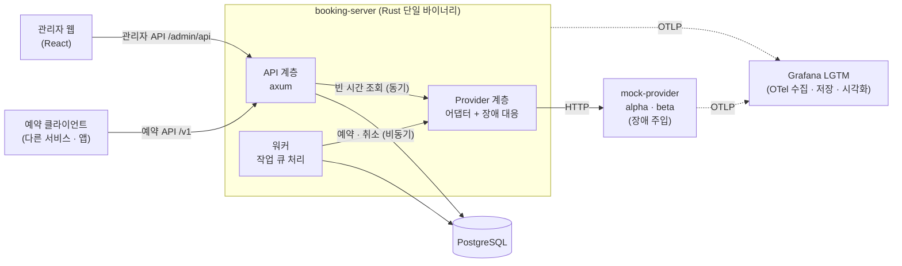
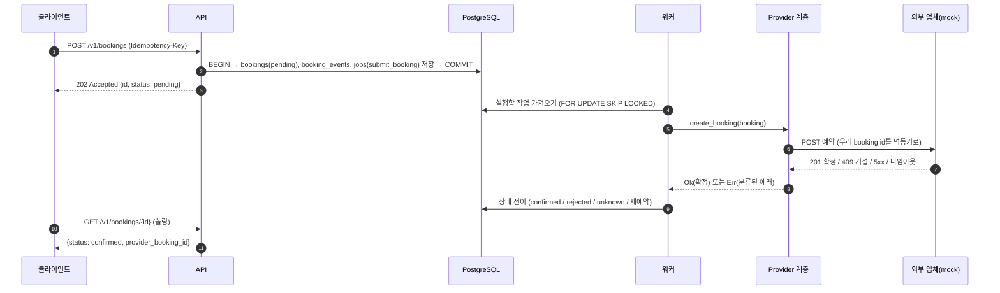
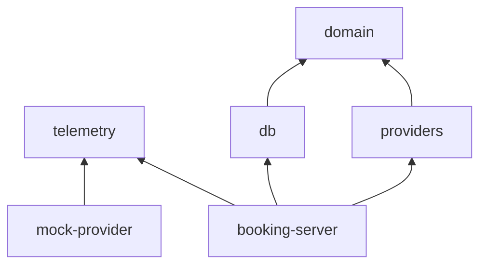

# 01. 아키텍처 개요

## 1. 목표와 비목표

### 목표
- 여러 외부 예약 업체(provider) API를 하나의 일관된 예약 API로 묶는다.
- 외부 업체가 느리거나, 실패하거나, 호출을 제한해도 **예약 데이터가 틀어지지 않는다** (이중 예약 0건, 유실 0건).
- 외부 호출을 한 건씩 기록하고 측정해서 p95 지연, 성공률, rate limit 사용량을 분석할 수 있다.
- 관리자가 화면에서 상태를 보고, 실패 건을 재처리하고, 업체 정책을 조정할 수 있다.
- 학습 프로젝트이므로 단계마다 실제로 돌려 볼 수 있는 결과물이 나온다.

### 비목표 (지금은 하지 않음)
- 실제 업체 연동, 결제
- 여러 인스턴스로 수평 확장 (서킷 브레이커와 rate limit 상태를 프로세스 메모리에 둔다 → [D-10](decisions.md#d-10-서킷rate-limit-상태는-프로세스-메모리에-단일-인스턴스-전제))
- Kubernetes 배포

## 2. 시스템 구성도



## 3. 구성 요소

| 구성 요소 | 책임 |
|---|---|
| API 계층 | 요청 검증, 인증, 멱등성 처리, 예약 저장과 작업 등록(한 트랜잭션), 조회 |
| 워커 | `jobs` 테이블에서 할 일을 꺼내 업체를 호출하고, 결과에 따라 예약 상태를 바꾸고, 실패하면 다시 예약. 업체마다 루프를 따로 둬 한 업체가 느려도 다른 업체 작업이 밀리지 않는다 ([D-30](decisions.md#d-30-워커는-업체마다-루프를-따로-두고-작업에-업체를-적는다-jobsprovider_id)). 업체마다 정기적으로 대사를 돈다 |
| Provider 계층 | 업체별 API 차이를 숨기는 **어댑터**, 그 바깥을 감싸는 **장애 대응 파이프라인**(타임아웃 · 재시도 · rate limit · 서킷 브레이커 · bulkhead), 호출 기록 |
| mock-provider | 성격이 다른 가짜 업체 2개(alpha, beta)와 장애 주입 API |
| 관리자 웹 | 대시보드, 예약 · 작업 조회와 재처리, 업체 정책 편집, 대사 이슈 확인, 장애 주입 제어, 감사 로그. 로그인과 역할별 권한 |
| PostgreSQL | 예약, 상태 이력, 작업 큐, 업체 호출 기록, 대사 이슈, 관리자 계정 · 세션 · 감사 로그 |
| Grafana LGTM | 추적(Tempo), 메트릭(Prometheus), 로그(Loki), 대시보드(Grafana) |

## 4. 핵심 흐름: 예약 생성

예약 생성은 **비동기**로 처리한다. 클라이언트에게는 바로 `202 Accepted`를 돌려주고, 실제 업체 호출은 워커가 한다. 이유는 [D-03](decisions.md#d-03-예약-생성은-비동기202--postgresql-작업-큐)에 있다.



실패했을 때의 동작(재시도, 결과 불명, 서킷 열림 등)은 [03-resilience.md](03-resilience.md)에서 다룬다.

## 5. 프로세스와 포트

`booking-server`는 바이너리 하나로 API와 워커를 함께 돌린다. 실행 옵션으로 역할을 고를 수 있다(`--role all|api|worker`, 기본값 `all`). → [D-04](decisions.md#d-04-단일-바이너리-역할-선택---role-allapiworker)

| 프로세스 | 포트 | 비고 |
|---|---|---|
| booking-server | 8080 | 예약 API, 관리자 API, 관리자 웹 정적 파일, `/docs`(API 문서) |
| mock-provider | 9090 | `/alpha/...`, `/beta/...`, `/_chaos`, `/_inspect` |
| PostgreSQL | 5432 | Docker |
| Grafana | 3000 | Docker (`grafana/otel-lgtm`) |
| OTLP 수신 | 4317 (gRPC), 4318 (HTTP) | 위와 같은 컨테이너 |
| Vite 개발 서버 | 5173 | 관리자 웹 개발 중에만 |

## 6. 저장소 구조 (Cargo workspace)

```
booking-web-app-rs/
├─ Cargo.toml                 # workspace 정의 (≈ .sln)
├─ crates/
│  ├─ domain/                 # 예약 모델, 상태 머신, 도메인 에러. I/O 없음
│  ├─ telemetry/              # tracing · OpenTelemetry 초기화 (서버와 mock이 함께 씀)
│  ├─ providers/              # ProviderAdapter trait, alpha · beta 어댑터, 장애 대응 파이프라인, 호출 기록기
│  ├─ db/                     # sqlx 기반 저장소(repository) 함수
│  ├─ booking-server/         # 실행 파일: axum API + 워커
│  └─ mock-provider/          # 실행 파일: 가짜 외부 업체 서버
├─ migrations/                # sqlx 마이그레이션 SQL
├─ web/admin/                 # React 관리자 웹 (Rust 크레이트 아님)
├─ observability/             # Grafana 대시보드 JSON, 알림 규칙
├─ docker-compose.yml         # postgres, otel-lgtm
└─ docs/
```

크레이트 의존 방향(화살표 = "사용한다"). `domain`은 다른 크레이트에 의존하지 않으므로 가장 먼저 만들고 가장 쉽게 테스트할 수 있다.



mock-provider는 일부러 `domain`에 의존하지 않는다. 진짜 외부 업체처럼 우리 코드와 독립적이어야 하기 때문이다.

`providers`는 `telemetry`에 의존하지 않는다. 지표와 trace 전파에는 외부 크레이트인 OpenTelemetry **API**만 쓰고, 어디로 내보낼지는 실행 파일이 `telemetry`로 정한다. → [D-20](decisions.md#d-20-라이브러리-크레이트는-opentelemetry-api만-쓰고-sdk-구성은-telemetry-크레이트에만-둔다)

## 7. 기술 스택

| 영역 | 선택 | .NET에서 비슷한 것 |
|---|---|---|
| 언어 / 빌드 | Rust (stable), Cargo | C#, dotnet CLI + NuGet |
| 비동기 런타임 | tokio | Task + ThreadPool |
| 웹 프레임워크 | axum | ASP.NET Core Minimal API |
| 미들웨어 | tower, tower-http | ASP.NET Core 미들웨어 |
| 장애 대응 | tower + governor(rate limit) + 직접 구현(서킷 브레이커, 재시도) | Polly |
| JSON | serde, serde_json | System.Text.Json |
| DB | PostgreSQL + sqlx | Dapper (단, SQL을 컴파일 시점에 검사) |
| 마이그레이션 | sqlx-cli | EF Core Migrations / DbUp |
| HTTP 클라이언트 | reqwest | HttpClient |
| 설정 | figment (파일 + 환경 변수) | IConfiguration + IOptions |
| 런타임 설정 교체 | arc-swap | IOptionsMonitor |
| 캐시 | moka | IMemoryCache |
| 비밀번호 해시 | argon2 (argon2id) | ASP.NET Core Identity의 `PasswordHasher` (PBKDF2) |
| 로그 · 추적 | tracing + opentelemetry | ILogger + Activity (System.Diagnostics) |
| API 문서 | utoipa + Swagger UI | Swashbuckle / NSwag |
| 에러 타입 | thiserror(라이브러리), anyhow(실행 파일) | 커스텀 Exception 계층 |
| ID | UUID v7 (`uuid` 크레이트) | `Guid.CreateVersion7()` (.NET 9+) |
| 시간 | chrono | DateTimeOffset |
| 테스트 | cargo test / cargo-nextest, wiremock, testcontainers, insta | xUnit, WireMock.Net, Testcontainers, Verify |
| 부하 테스트 | oha, goose | NBomber, k6 |
| 관리자 웹 | React + TypeScript + Vite, Mantine, TanStack Query | (Blazor 대신) |

## 8. C# 개발자를 위한 Rust 개념 대응표

| C# | Rust | 메모 |
|---|---|---|
| `interface` | `trait` | 이미 있는 타입에도 나중에 구현을 붙일 수 있다 |
| 예외 (`throw` / `catch`) | `Result<T, E>` + `?` 연산자 | 실패 가능성이 함수 시그니처에 드러난다 |
| `null`, `T?` | `Option<T>` | null이 없다. 컴파일러가 `None` 처리를 강제한다 |
| 판별 공용체 흉내 (abstract record 계층) | 값을 담는 `enum` + `match` | 예약 상태와 에러 분류에 적극 사용한다 |
| DI 컨테이너 | 없음. `AppState`를 만들어 axum `State`로 전달 | 의존성이 코드에 명시적으로 드러난다 |
| `BackgroundService` | `tokio::spawn`으로 띄운 태스크 | 워커, 호출 기록기 |
| `CancellationToken` | `tokio_util::sync::CancellationToken` | 정상 종료(graceful shutdown) |
| `SemaphoreSlim` | `tokio::sync::Semaphore` | bulkhead |
| `Channel<T>` | `tokio::sync::mpsc` | 호출 기록기 |
| `Func<Task<T>>`를 받는 제네릭 메서드 | 제네릭 함수 + 클로저 (`F: FnMut() -> Fut`) | `ResilientProvider::call`: 재시도마다 클로저를 다시 불러 새 요청을 만든다 |
| `task.WaitAsync(timeout)` | `tokio::time::timeout` | 시간 안에 끝나지 않으면 Future를 버린다 (요청 취소) |
| `using` / `IDisposable` | `Drop` (값이 사라질 때 자동 정리) | bulkhead 자리(`SemaphorePermit`)는 drop될 때 반납된다 |
| `Interlocked.Increment` | `AtomicU64::fetch_add` | 잠금 없이 여러 스레드가 함께 올리는 카운터 |
| `System.Threading.RateLimiting` | governor | 업체별 rate limiter |
| GC | 소유권(ownership)과 빌림(borrowing) | 여러 곳에서 공유하려면 `Arc<T>` (참조 카운트 포인터) |
| `.csproj` / `.sln` | crate / workspace | |
| `[Attribute]` | `#[derive(...)]`, 속성 매크로 | `#[derive(Serialize)]`는 JSON 직렬화 코드를 자동 생성 |
| 미들웨어 클래스 (`InvokeAsync(context, next)`) | tower `Layer` + `Service` | `Layer`는 안쪽 `Service`를 감싼 `Service`를 만드는 공장. `telemetry::HttpTelemetryLayer` |
| `Activity` / `ActivitySource` | tracing span, `#[tracing::instrument]` | 함수 실행 동안 span을 연다. `skip_all`로 인자를 기록하지 않게 한다 (개인정보) |
| `Activity.Current` | `tracing::Span::current()` | async에서는 `.instrument(span)`으로 Future에 span을 붙인다 (await 사이에도 유지) |
| `Meter`, `Counter<T>`, `Histogram<T>` | `opentelemetry::metrics::{Meter, Counter, Histogram}` | 라이브러리는 API만 쓰고, SDK 구성은 실행 파일이 한다 |
| `Meter.CreateObservableGauge` | `meter.u64_observable_gauge(..).with_callback(..)` | 내보낼 때마다 콜백으로 현재 값을 읽는다 |
| `static readonly` 필드 + `Lazy<T>` | `static X: LazyLock<T>` | 처음 쓸 때 한 번 초기화되는 전역 값 (계측기 묶음) |
| `WeakReference<T>` | `std::sync::Weak<T>` | 값을 살려 두지 않는 참조. `upgrade()`로 살아 있는지 확인하고 쓴다 |
| `using var x = …` (끝날 때 `Dispose`) | 값을 변수에 담아 두기 + `Drop` | `let _telemetry = telemetry::init(..)?;` 사라질 때 남은 데이터를 내보낸다. `let _ =`로 받으면 바로 사라진다 |
| `#if SYMBOL`, 조건부 패키지 참조 | Cargo feature, `#[cfg(feature = "…")]` | `--features tokio-console`로 켠 기능의 코드와 의존성만 컴파일한다 |
| `#if` 안에서만 붙이는 특성(attribute) | `#[cfg_attr(feature = "openapi", derive(utoipa::ToSchema))]` | 조건이 참일 때만 속성을 붙인다. domain은 API 문서를 만드는 빌드에서만 스키마를 derive한다 (D-25) |
| Swashbuckle, `[ProducesResponseType]` | `#[utoipa::path(...)]`, `#[derive(ToSchema)]` | 핸들러 · 타입의 속성에서 OpenAPI 문서를 만든다. `routes!(핸들러)`가 라우트 등록과 문서 경로를 함께 한다 |
| 예외 필터에서 `FormatException` → 400 | `impl From<QueryRejection> for ApiError` + `?` | `?`는 에러를 돌려주기 전에 `From`으로 함수의 에러 타입에 맞게 바꾼다 |
| `SortedDictionary<K, V>` | `BTreeMap<K, V>` | 키 순서로 정렬된 맵 (통계 구간 채우기, 종류별 개수) |
| `UPDLOCK` 힌트, `SELECT … FOR UPDATE` | sqlx로 `SELECT … FOR UPDATE` | 트랜잭션이 끝날 때까지 그 행을 다른 곳에서 바꾸지 못하게 잠근다 (관리자 재시도) |
| `IOptionsMonitor<T>.CurrentValue` | `ArcSwap<T>` (arc-swap) | 잠금 없이 읽고, 바꿀 때는 새 값으로 통째로 교체한다. `load_full()`로 받은 `Arc`는 그 뒤에 교체되어도 그대로라, 호출 하나가 시작할 때의 정책을 끝까지 쓴다 (업체 정책, D-34) |
| `Task.Run(() => CPU 작업)` | `tokio::task::spawn_blocking` | 오래 걸리는 CPU 작업(argon2 비밀번호 해시)을 블로킹 작업용 스레드에서 돌린다. async 태스크에서 그대로 돌리면 그 스레드의 다른 요청이 멈춘다 |
| `IMemoryCache` + 만료 시간 | moka `Cache` | 빈 시간 캐시. `time_to_live`가 지난 항목을 알아서 지운다 |
| `[Authorize(Roles = "...")]` | axum 추출기(`FromRequestParts`)를 구현한 타입 | 핸들러 매개변수에 `RequireOperator`를 두면 axum이 핸들러를 부르기 전에 권한을 확인한다. 실패하면 핸들러는 실행되지 않는다 |
| enum 값끼리 크기 비교 (`role >= Role.Operator`) | `#[derive(PartialOrd, Ord)]`를 붙인 enum | 선언한 순서대로 크기가 정해진다 (`Viewer < Operator < Admin`) |
| `Task.WhenAll(tasks)` | `tokio::task::JoinSet` | 업체별 워커 루프를 띄우고 모두 끝나기를 기다린다 |
| SQL Server의 필터된 유니크 인덱스(`WHERE`가 붙은 인덱스) + 중복 키 예외 처리 | PostgreSQL 부분 유니크 인덱스 + `INSERT … ON CONFLICT … DO NOTHING` | 예외 없이 "이미 있으면 넣지 않는다". "업체마다 대사 작업 하나", "같은 미해결 이슈는 하나"를 DB가 지킨다 |
