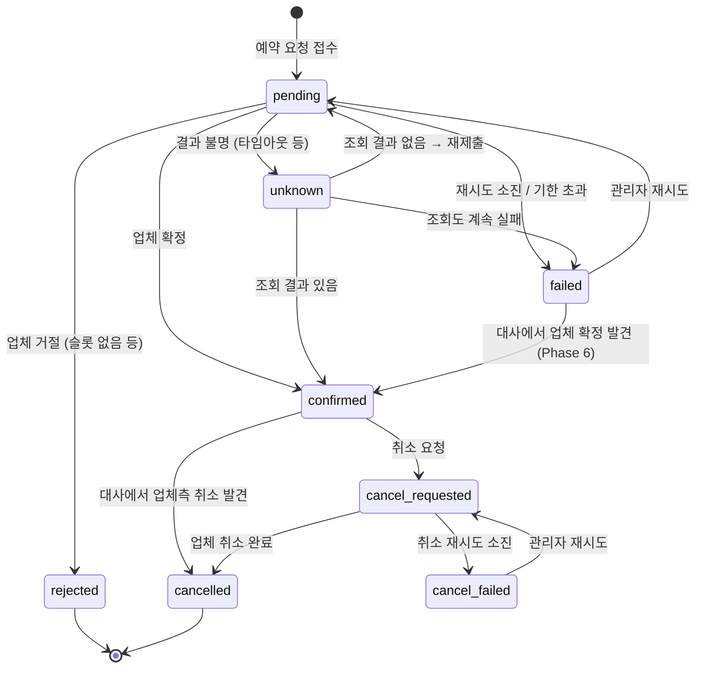

# 02. 도메인 모델과 데이터

## 1. 도메인 개념

예약 도메인은 특정 업종에 묶이지 않는 **"시간 슬롯 예약"** 모델로 잡는다. 식당, 숙소, 병원, 체험 상품이 모두 이 틀에 들어간다.

| 개념 | 설명 | 예 |
|---|---|---|
| Provider (업체) | 우리가 연동하는 외부 예약 시스템 | alpha, beta |
| Resource (자원) | 업체 안에서 예약 대상이 되는 단위 | 매장, 객실, 진료실 |
| Slot (슬롯) | 자원의 예약 가능한 시간 구간 | 2026-11-20 19:00~20:00, 잔여 3 |
| Booking (예약) | 우리 시스템의 예약 1건. 업체 예약과 1:1로 대응 | |
| Client (클라이언트) | 우리 예약 API를 호출하는 내부 서비스. API 키로 식별 | 모바일 앱 백엔드 |

자원과 슬롯의 원본은 **업체**에 있으므로 우리 DB에 저장하지 않는다. 조회할 때 업체에 묻고 짧게 캐시한다.

## 2. 예약 상태 머신



| 상태 | 의미 | 종료 상태 |
|---|---|---|
| `pending` | 접수됨. 업체 제출을 기다리거나 진행 중 | |
| `confirmed` | 업체가 확정함. `provider_booking_id`가 채워짐 | |
| `rejected` | 업체가 업무적으로 거절함 (슬롯 마감, 잘못된 요청) | ✅ |
| `unknown` | 생성 요청을 보냈지만 성공 여부를 알 수 없음 | |
| `failed` | 기술적 실패로 포기함. 관리자가 재시도할 수 있음 | 관리자 대기 |
| `cancel_requested` | 취소 요청 접수. 업체 취소 진행 중 | |
| `cancelled` | 취소 완료 | ✅ |
| `cancel_failed` | 취소 재시도 소진. 관리자 개입 필요 | 관리자 대기 |

`failed --> confirmed`는 Phase 6에서 추가했다. 결과 불명이었다가 조회도 실패해 포기한 예약이 실제로는 업체에 만들어져 있을 수 있는데, 대사가 그런 예약을 업체 목록에서 찾으면(`FoundAtProvider`) 확정으로 바로잡는다 ([03 §9](03-resilience.md#9-대사-reconciliation)). 전이는 모두 14개다.

규칙:
- 취소는 `confirmed` 상태에서만 받는다. `pending`이나 `unknown`에서 취소 요청이 오면 `409`를 돌려준다. 처리 중인 예약을 취소하면 경쟁 상태가 복잡해지므로 1차 범위에서는 뺀다.
- 상태가 바뀔 때마다 `booking_events`에 한 줄을 남긴다 (누가, 왜, 어떤 trace에서).
- 상태 변경 SQL은 항상 "현재 상태가 기대한 상태일 때만" 바꾼다: `UPDATE ... WHERE id = $1 AND status = $expected`. 바뀐 행이 0개면 다른 곳에서 먼저 바꾼 것이다 (낙관적 동시성 제어).

### Rust로 표현하기 (스케치)

```rust
#[derive(Debug, Clone, Copy, PartialEq, Eq, Serialize, Deserialize)]
#[serde(rename_all = "snake_case")]
pub enum BookingStatus {
    Pending, Confirmed, Rejected, Unknown, Failed,
    CancelRequested, Cancelled, CancelFailed,
}

/// 상태 전이를 일으키는 사건
pub enum BookingEvent {
    ProviderConfirmed { provider_booking_id: String },
    ProviderRejected { reason: RejectReason },
    OutcomeUnknown,
    GaveUp { reason: String },
    FoundAtProvider { provider_booking_id: String },
    NotFoundAtProvider,
    AdminRetry,
    CancelRequested,
    CancelConfirmed,
    CancelGaveUp,
    CancelledExternally,
}

impl BookingStatus {
    /// 허용되지 않은 전이는 Err를 돌려준다.
    pub fn apply(self, event: &BookingEvent) -> Result<BookingStatus, InvalidTransition> {
        match (self, event) {
            (Self::Pending, BookingEvent::ProviderConfirmed { .. }) => Ok(Self::Confirmed),
            // ... 전이표의 14개 전이
            (from, event) => Err(InvalidTransition { from, event: event.name() }),
        }
    }
}
```

`apply`에는 나머지를 모두 거절하는 `(from, event) => Err(..)` 줄이 있어서, 상태를 추가해도 컴파일러가 `apply`에서 빠진 곳을 알려 주지는 않는다.
대신 단위 테스트가 다음 두 가지로 이를 보완한다 (`crates/domain/src/status.rs`).
- 모든 상태 × 모든 사건 조합을 위 전이표와 비교한다.
- 상태 · 사건 목록을 `_` 없이 나열한 `match`를 둬서, 목록에 빠진 값이 있으면 컴파일이 되지 않게 한다.

```rust
// (구현은 crates/domain 참고)
```

상태 전이 규칙은 `domain` 크레이트에 순수 함수로 두고, DB 없이 단위 테스트로 모든 전이를 검증한다.

## 3. 멱등성 (이중 예약 방지)

멱등성은 **두 군데**에서 지킨다.

**① 클라이언트 → 우리 API**
- `POST /v1/bookings`에는 `Idempotency-Key` 헤더가 꼭 있어야 한다.
- `bookings` 테이블의 `UNIQUE (client_id, idempotency_key)` 제약으로 중복을 막는다.
- 같은 키로 다시 오면, 요청 본문 해시(`request_hash`)가 같을 때는 기존 예약을 그대로 돌려주고, 다를 때는 `422 idempotency_key_reused`를 돌려준다.

**② 우리 → 외부 업체**
- 우리 `booking.id`(UUID v7)를 업체에 보내는 참조값으로 쓴다.
- alpha처럼 `Idempotency-Key`를 지원하는 업체는 같은 키로 재시도하면 업체가 중복 생성을 막는다. 그래서 타임아웃 뒤에 재시도해도 안전하다.
- beta처럼 지원하지 않는 업체는 생성 결과가 불분명하면 **재시도하지 않는다**. `unknown`으로 두고 `external_ref`로 조회해서 확인한 뒤에만 다시 제출한다 ([03-resilience.md §5](03-resilience.md#5-결과-불명-unknown-outcome-처리)).

## 4. 데이터베이스 스키마 (초안)

모든 시각은 `timestamptz`(UTC로 저장), ID는 UUID v7(시간순으로 정렬되어 인덱스에 유리)을 쓴다.

```sql
-- 우리 API를 호출하는 내부 클라이언트
CREATE TABLE api_clients (
    id            uuid PRIMARY KEY,
    name          text NOT NULL,
    api_key_hash  text NOT NULL UNIQUE,          -- 원문은 저장하지 않음
    created_at    timestamptz NOT NULL DEFAULT now()
);

-- 외부 업체와 업체별 정책 (관리자 화면에서 편집)
CREATE TABLE providers (
    id            text PRIMARY KEY,              -- 'alpha', 'beta'
    display_name  text NOT NULL,
    adapter_kind  text NOT NULL,                 -- 'alpha_v1', 'beta_v1'
    base_url      text NOT NULL,
    enabled       boolean NOT NULL DEFAULT true,
    policy        jsonb NOT NULL,                -- 타임아웃 · 재시도 · rate limit · 서킷 설정 (03-resilience.md §3)
    updated_at    timestamptz NOT NULL DEFAULT now()
);

CREATE TABLE bookings (
    id                   uuid PRIMARY KEY,
    client_id            uuid NOT NULL REFERENCES api_clients(id),
    idempotency_key      text NOT NULL,
    request_hash         bytea NOT NULL,
    provider_id          text NOT NULL REFERENCES providers(id),
    resource_id          text NOT NULL,
    slot_start           timestamptz NOT NULL,
    party_size           int  NOT NULL CHECK (party_size > 0),
    customer             jsonb NOT NULL,         -- {name, phone}
    status               text NOT NULL,
    status_reason        text,
    provider_booking_id  text,
    deadline_at          timestamptz NOT NULL,   -- 이 시각까지 확정하지 못하면 failed
    created_at           timestamptz NOT NULL DEFAULT now(),
    updated_at           timestamptz NOT NULL DEFAULT now(),
    UNIQUE (client_id, idempotency_key)
);
CREATE INDEX bookings_status_idx   ON bookings (status, updated_at);
CREATE INDEX bookings_provider_idx ON bookings (provider_id, slot_start);

-- 상태 변경 이력 (관리자 화면의 타임라인, 감사 기록)
CREATE TABLE booking_events (
    id           bigserial PRIMARY KEY,
    booking_id   uuid NOT NULL REFERENCES bookings(id),
    from_status  text,
    to_status    text NOT NULL,
    reason       text,
    actor        text NOT NULL,                  -- 'api', 'worker', 'reconciler', 'admin:<이름>'
    trace_id     text,
    at           timestamptz NOT NULL DEFAULT now()
);
CREATE INDEX booking_events_booking_idx ON booking_events (booking_id, at);

-- 작업 큐 (Transactional Outbox 역할도 함)
CREATE TABLE jobs (
    id             bigserial PRIMARY KEY,
    kind           text NOT NULL,                -- submit_booking, resolve_unknown, cancel_booking, reconcile_provider
    booking_id     uuid REFERENCES bookings(id),
    payload        jsonb NOT NULL DEFAULT '{}',
    status         text NOT NULL DEFAULT 'queued', -- queued, running, done, dead
    attempts       int  NOT NULL DEFAULT 0,
    max_attempts   int  NOT NULL,
    run_at         timestamptz NOT NULL DEFAULT now(),
    locked_until   timestamptz,
    last_error     text,
    trace_context  jsonb,                        -- 작업을 만든 요청의 traceparent
    created_at     timestamptz NOT NULL DEFAULT now(),
    updated_at     timestamptz NOT NULL DEFAULT now()
);
CREATE INDEX jobs_ready_idx ON jobs (run_at) WHERE status = 'queued';

-- 외부 업체 호출 기록 (시도 1번 = 1행). 통계 · 분석의 원천 데이터
CREATE TABLE provider_calls (
    id                    bigserial PRIMARY KEY,
    provider_id           text NOT NULL,
    operation             text NOT NULL,         -- availability, create_booking, find_booking, cancel_booking, list_bookings
    booking_id            uuid,
    job_id                bigint,
    attempt               int  NOT NULL,         -- 호출 내 재시도 번호 (1부터)
    started_at            timestamptz NOT NULL,
    duration_ms           int  NOT NULL,
    outcome               text NOT NULL,         -- 03-resilience.md §1의 분류
    http_status           int,
    rate_limit_remaining  int,                   -- 업체 응답 헤더에서 읽은 값
    retry_after_ms        int,
    error_detail          text,
    trace_id              text
);
CREATE INDEX provider_calls_time_idx    ON provider_calls (provider_id, started_at);
CREATE INDEX provider_calls_booking_idx ON provider_calls (booking_id) WHERE booking_id IS NOT NULL;

-- 대사(reconciliation)에서 찾은 불일치
CREATE TABLE reconciliation_issues (
    id                   bigserial PRIMARY KEY,
    provider_id          text NOT NULL,
    booking_id           uuid,
    provider_booking_id  text,
    kind                 text NOT NULL,          -- missing_at_provider, missing_locally, status_mismatch, duplicate_suspected
    detail               jsonb NOT NULL,
    detected_at          timestamptz NOT NULL DEFAULT now(),
    resolved_at          timestamptz,
    resolved_by          text
);
```

관리자 인증용 `admin_users` 테이블은 Phase 6에서 추가한다.
→ Phase 6에서 추가: `admin_users` · `admin_sessions` · `admin_audit_log`, 그리고 `jobs.provider_id` · `jobs.sent_at` (아래 "구현 메모 (Phase 6)").

### 구현 메모 (Phase 2)
- 테이블은 그 기능을 만드는 Phase에서 마이그레이션으로 추가한다. Phase 2 마이그레이션(`migrations/20261110000001_create_booking_core.sql`)에는 `api_clients`, `providers`, `bookings`, `booking_events`, `jobs`만 있다. `provider_calls`는 Phase 3, `reconciliation_issues`는 Phase 6.
- `bookings.status`와 `jobs.status`에는 허용 값 CHECK 제약을 걸었다. 상태를 추가하려면 제약을 바꾸는 새 마이그레이션이 필요하다.
- 같은 마이그레이션이 로컬 개발용 업체 `alpha`(`http://127.0.0.1:9090/alpha/v1`)를 넣는다. 다른 환경에서는 `providers.base_url`을 그 환경 주소로 바꾼다.
- 고객 정보(`customer`)는 API 응답에 넣지 않고, 로그에 찍혀도 `Debug`에서 `***`로 가려진다.
- `timestamptz`는 마이크로초까지만 저장한다. 그런데 Linux의 `Utc::now()`는 나노초까지 돌려주므로, 저장할 시각은 API 입구에서 `db::normalize_timestamp`로 마이크로초에 맞춘다. 그래야 요청 해시를 계산한 값, 저장한 값, 다시 읽은 값이 같다. (macOS는 시계가 마이크로초 단위라 로컬에서는 이 차이가 드러나지 않는다)

### 구현 메모 (Phase 3)
- `provider_calls`는 `migrations/20261111000001_create_provider_calls.sql`에서 추가했다. 기록 테이블이라 보관 기간이 예약과 다르므로 `booking_id`에 외래 키를 걸지 않았다. `trace_id`는 Phase 4(OpenTelemetry)에서 채운다.
- 저장은 `db::provider_calls::insert_batch` 한 문장으로 한다. 열마다 값을 배열로 모아 보내고 `UNNEST`로 펼치므로, 건수와 상관없이 `query!`로 컴파일 시점에 검사된다.
- `jobs.kind`에 `resolve_unknown`이 추가되었다. `jobs.payload`는 작업별 진행 상황(지금은 `resolve_unknown`이 "업체에 없음"을 확인한 횟수)을 담는다.
- 예약 상태 전이와 "그 상태를 처리할 다음 작업" 등록을 한 트랜잭션으로 묶는다: `unknown`이 되면 `resolve_unknown`, `unknown → pending`이 되면 `submit_booking`.

### 구현 메모 (Phase 4)
- 처음부터 스키마에 있던 trace 컬럼을 채운다. 값은 booking-server가 만들고, db 크레이트는 해석하지 않고 저장만 한다 (`db::TraceRef`).
  | 컬럼 | 내용 |
  |---|---|
  | `booking_events.trace_id` | 그 상태 변경을 일으킨 trace. 접수는 요청의 trace, 확정 · 실패는 작업의 trace |
  | `jobs.trace_context` | 작업을 등록한 쪽의 trace 문맥 `{"traceparent": "00-<trace id>-<span id>-01"}`. 워커가 작업 span에 link로 건다 |
  | `provider_calls.trace_id` | 그 호출 시도가 속한 trace |
- OpenTelemetry를 설치하지 않은 곳(테스트 등)에서는 세 컬럼 모두 NULL이다.
- `migrations/20261112000001_add_jobs_dead_index.sql`: dead 작업용 부분 인덱스 `jobs_dead_idx`. `jobs.dead` 지표를 내려고 몇 초마다 세는 조회가 끝난 작업이 쌓여도 느려지지 않게 한다 (Phase 5의 dead 작업 목록도 쓴다).
- `db::jobs::claim_next`가 작업을 가져가면서 "실행하기로 한 시각보다 얼마나 밀렸는지"(`now() - run_at`)를 함께 돌려준다 (`jobs.lag` 지표).

### 구현 메모 (Phase 5)
- 새 마이그레이션은 없다. 관리자 화면의 조회는 기존 인덱스를 쓴다: 예약 목록은 기본 키(UUID v7이라 ID 순서 = 접수 순서)로 커서를 넘기고, dead 작업 목록은 `jobs_dead_idx`, 호출 통계는 `provider_calls_time_idx (provider_id, started_at)`.
- 목록 조회의 선택 조건은 `($1::text IS NULL OR status = $1)`처럼 쓴다. 조건 조합마다 SQL을 따로 만들지 않고 문장 하나로 `query_as!`의 컴파일 시점 검사를 받는다.
- 업체별 요약 통계는 업체 ID 목록을 받아 `provider_id = ANY($1)`로 찾는다 (인덱스가 업체 ID부터 시작하므로 시각 조건만 쓰면 테이블 전체를 훑는다).
- 관리자 재시도 (`booking_server::api::admin::retry`, [D-26](decisions.md#d-26-관리자-재시도는-예약을-잠그고-dead-작업을-같은-행으로-되살리고-기한을-다시-잡고-보내기-전에-업체에서-먼저-찾는다)), 한 트랜잭션:
  1. `bookings::get_for_update`: 예약 행을 잠그고 읽는다 (`SELECT … FOR UPDATE`). 같은 예약에 대한 동시 조작이 차례로 처리된다.
  2. `jobs::has_active_for_booking`: 대기 · 실행 중인 작업이 있으면 거절 (한 예약에 처리 중인 작업은 하나).
  3. `bookings::transition(failed → pending, AdminRetry, actor "admin")`, `bookings::set_deadline`(지금부터 다시 계산한 확정 기한).
  4. `jobs::requeue`: 그 예약의 dead 작업을 같은 행으로 되살린다 (`status = 'queued'`, `run_at = now()`, 종류 · payload · trace 문맥 교체. `WHERE status = 'dead'`라서 두 번 되살리지 않는다). dead 작업이 없으면 `jobs::enqueue_with_payload`로 새로 등록한다.
  - `attempts`는 되돌리지 않고 `max_attempts = attempts + 8`로 한도를 늘린다. `attempts`가 lease 증표라 같은 번호가 다시 나오면 lease를 잃은 옛 워커의 늦은 쓰기를 막지 못한다 (위 "lease와 fencing").
- `submit_booking` 작업의 `payload`에 `{"lookup_first": true}`가 있으면 워커가 보내기 전에 업체에서 먼저 찾는다 ([03 §5](03-resilience.md#5-결과-불명-unknown-outcome-처리)). payload 형식이 깨졌으면 더 조심하는 쪽(조회부터)으로 읽는다.
- `JobRecord`에 `locked_until` · `created_at` · `updated_at`을 더했다 (관리자 화면의 작업 목록).
- dead 작업 목록은 전용 쿼리(`status = 'dead'`를 상수로 적은 것)로 읽는다. "조건이 NULL이면 건너뛰는" 쿼리는 prepared statement의 일반 실행 계획에서 부분 인덱스 `jobs_dead_idx`를 쓰지 못해, 끝난 작업이 쌓일수록 느려진다.

### 구현 메모 (Phase 6)

| 마이그레이션 | 내용 |
|---|---|
| `20261113000001_add_jobs_provider_and_sent.sql` | `jobs.provider_id`(작업이 부르는 업체, 기존 작업은 예약에서 채움) + 업체별 대기 인덱스 `jobs_provider_ready_idx`, `jobs.sent_at`("보냄" 표시), 업체마다 대사 작업을 하나로 묶는 부분 유니크 인덱스 `jobs_reconcile_active_idx` |
| `20261113000002_create_reconciliation_issues.sql` | `reconciliation_issues` (종류 CHECK 제약), 미해결 이슈를 (업체, 종류, 예약, 업체 예약)마다 하나로 묶는 부분 유니크 인덱스 (`NULLS NOT DISTINCT`) |
| `20261113000003_create_admin_auth.sql` | `admin_users`(argon2 해시, 역할 CHECK), `admin_sessions`(토큰의 SHA-256 해시가 기본 키), `admin_audit_log` |
| `20261113000004_add_beta_provider.sql` | 로컬 개발용 업체 `beta` (`http://127.0.0.1:9090/beta/api`, 멱등키 없음) |

- **작업의 업체** ([D-30](decisions.md#d-30-워커는-업체마다-루프를-따로-두고-작업에-업체를-적는다-jobsprovider_id)): 예약 작업은 등록하는 SQL 안에서 예약의 업체를 읽어 넣는다 (`(SELECT provider_id FROM bookings WHERE id = $2)`). 예약의 업체는 바뀌지 않으므로 함께 바꿀 일이 없다. 워커 루프는 `provider_id = $1` 조건으로 자기 업체의 작업만 가져간다 (§5).
- **"보냄" 표시** ([D-31](decisions.md#d-31-멱등키-없는-업체에는-보내기-직전에-보냄-표시를-커밋한다-jobssent_at)): `jobs::mark_sent`가 lease 증표 조건으로 `sent_at = now()`를 남기면서 `locked_until`도 지금부터 lease만큼으로 새로 잡는다. 결과를 남기는 SQL(`complete` · `retry_later` · `defer` · `mark_dead` · `requeue` 등)이 모두 `sent_at = NULL`로 지운다. 업체 호출 뒤에 할 일이 많은 대사 작업은 `jobs::extend_lease`로 lease를 늘린다.
- **포기하려는데 예약이 그사이 바뀌었으면** (다른 경로가 먼저 처리함, 낙관적 전이 충돌) 작업을 dead로 남기지 않고 끝내기만 한다. dead 표시와 상태 전이가 한 트랜잭션이라 전이가 막히면 그 트랜잭션을 버리고 완료로 기록한다. 예약은 멀쩡한데 dead 작업이 남아 "dead 작업이 있음" 알림이 울리는 일을 막는다 (독립 리뷰에서 지적: 결과 불명 확인의 포기와 대사의 확정이 겹친 경우).
- **대사 작업은 업체마다 하나** ([D-33](decisions.md#d-33-대사는-업체별-작업-체인으로-돌고-자동으로-바로잡을-것과-사람에게-넘길-것을-나눈다)): `jobs::schedule_reconcile`은 `INSERT … ON CONFLICT (provider_id) WHERE kind = 'reconcile_provider' AND status IN ('queued', 'running') DO NOTHING`이다. 부분 유니크 인덱스를 `ON CONFLICT`의 대상으로 쓰려면 인덱스와 **같은 `WHERE` 조건**을 적어야 PostgreSQL이 그 인덱스를 찾는다. `jobs::run_reconcile_now`는 대기 중인 대사 작업의 `run_at`을 지금으로 당긴다 (없으면 새로 등록, 실행 중이면 그 작업).
- **이슈 기록** (`db::reconciliation::record`): `ON CONFLICT … DO NOTHING`이라 같은 미해결 이슈가 있으면 새로 넣지 않는다. 자동으로 바로잡은 이슈는 처음부터 `resolved_at` · `resolved_by = 'reconciler'`를 채워 넣는다 (부분 인덱스 밖이라 겹쳐도 남는다).
- **대사가 실패 예약을 바로잡을 때** 그 예약의 dead 작업을 `status = 'done'`으로 정리한다 (`jobs::close_dead_for_booking`). 포기한 대사 작업을 관리자가 다시 넣을 때도 그 행을 `done`으로 정리하고(`jobs::close_dead`) 대기 중인 대사를 당긴다. 되살리면 하나뿐인 대사 자리와 겹쳐 유니크 인덱스에 걸린다 (처음 구현은 500이 났다. 문서를 쓰다 발견).
- **대사의 우리 쪽 예약** (`bookings::for_reconciliation`): 업체와 슬롯 기간으로 고른다 (`bookings_provider_idx (provider_id, slot_start)`).
- **관리자 세션**: 쿠키의 토큰을 SHA-256으로 해시해 `admin_sessions`의 기본 키로 바로 찾는다 (만료 시각 조건 포함). 로그인할 때 그 관리자의 만료된 세션을 같은 트랜잭션에서 지우고, 로그아웃하면 그 세션을 지운다 (§6).
- 관리자 조작과 감사 로그는 한 트랜잭션이다. `admin_audit_log.actor`와 `booking_events.actor`는 `admin:<이름>`이다.

## 5. 작업 큐 동작

별도 메시지 브로커(RabbitMQ, Kafka) 없이 PostgreSQL 테이블로 작업 큐를 만든다. → [D-03](decisions.md#d-03-예약-생성은-비동기202--postgresql-작업-큐)

**예약 접수 (한 트랜잭션)**
```sql
BEGIN;
  INSERT INTO bookings (...) ON CONFLICT (client_id, idempotency_key) DO NOTHING;
  INSERT INTO booking_events (to_status = 'pending', ...);
  INSERT INTO jobs (kind = 'submit_booking', booking_id = ..., trace_context = 현재 trace);
COMMIT;
```
예약 저장과 작업 등록이 함께 성공하거나 함께 실패하므로 "저장은 됐는데 업체에 보내지지 않은" 예약이 생기지 않는다.

**작업 가져오기** (워커가 여러 개 돌아도 같은 작업을 동시에 집지 않음)
```sql
UPDATE jobs
SET status = 'running', attempts = attempts + 1,
    locked_until = now() + interval '60 seconds', updated_at = now()
WHERE id IN (
    SELECT id FROM jobs
    WHERE (status = 'queued'  AND run_at <= now())
       OR (status = 'running' AND locked_until < now())   -- 처리 도중 죽은 워커의 작업 회수
    ORDER BY run_at
    LIMIT $1
    FOR UPDATE SKIP LOCKED
)
RETURNING *;
```

**작업 결과 처리**
| 결과 | 처리 |
|---|---|
| 성공 | `status = 'done'`, 같은 트랜잭션에서 예약 상태 전이 |
| 다시 시도할 만한 실패 | `status = 'queued'`, `run_at = now() + 백오프` |
| 업체를 호출하지 않고 미룬 경우 (서킷 열림, 업체 pause, 우리 쪽 대기 한도 초과) | 위와 같지만 `attempts`를 되돌린다 (실제로 호출하지 않았으므로, `db::jobs::defer`). 대신 예약의 `deadline_at`으로 전체 기한을 제한한다 |
| 횟수 소진 또는 기한 초과 | `status = 'dead'`, 예약을 `failed` 또는 `cancel_failed`로 전이. 관리자 화면에 표시 |

폴링 간격은 500ms로 시작한다. 지연을 더 줄이고 싶으면 나중에 PostgreSQL `LISTEN/NOTIFY`로 워커를 깨우는 방식을 더한다.

**업체별 루프 (Phase 6)**: 워커는 업체마다 루프를 따로 두고, 위 SQL의 안쪽 `SELECT`에 업체 조건을 더해 자기 업체의 작업만 가져간다 ([D-30](decisions.md#d-30-워커는-업체마다-루프를-따로-두고-작업에-업체를-적는다-jobsprovider_id)). 실제 구현은 한 번에 한 건씩(`LIMIT 1`) 가져온다.
```sql
WHERE provider_id = $1 AND ((status = 'queued' AND run_at <= now()) OR (status = 'running' AND locked_until < now()))
-- 나머지 루프 하나: provider_id IS NULL OR provider_id <> ALL($이_프로세스의_업체들)
```

**lease와 fencing**: 작업을 가져갈 때 늘어난 `attempts` 값이 "이 작업을 쥐고 있다"는 증표다. 완료 · 재예약 · 포기 SQL은 모두 `WHERE id = $1 AND status = 'running' AND attempts = $n`으로 이 증표를 확인한다. 처리 도중 lease가 만료되어 다른 워커가 같은 작업을 다시 가져가면 `attempts`가 또 늘어나므로, 늦게 끝난 원래 워커의 결과는 반영되지 않는다. 작업 완료와 예약 상태 전이는 한 트랜잭션으로 저장한다.

미루기(`defer`)는 `attempts`를 1 되돌리므로, 미룬 작업을 다시 가져가면 같은 번호가 다시 나온다. 그래도 fencing은 깨지지 않는다: 미룬 워커는 그 쓰기가 마지막이라 그 번호로 다시 쓰지 않고, lease를 잃은 워커의 번호보다 작은 값으로는 돌아가지 않는다 (다른 워커가 가져가면서 이미 1을 더했으므로).

**시각 기준**: `run_at`, `locked_until` 계산은 모두 DB의 `now()`로 한다. 서버가 여러 대여도 시계 하나를 기준으로 삼기 위해서다. 예약의 `deadline_at`만 API 서버가 접수 시각으로 계산한다.

## 6. 보관 정책

| 테이블 | 보관 기간 | 방법 |
|---|---|---|
| `provider_calls` | 30일 | 매일 정리 작업이 삭제. 장기 추세가 필요하면 시간 단위 집계 테이블을 추가 (Phase 7 이후) |
| `jobs` (`done`) | 7일 | 매일 정리 |
| `admin_sessions` (만료된 것) | 만료 뒤 정리 | 그 관리자가 다시 로그인할 때 지운다. 다시 로그인하지 않는 관리자의 것은 정리 작업과 함께 (Phase 7) |
| 나머지 (`reconciliation_issues`, `admin_audit_log` 포함) | 영구 | |
