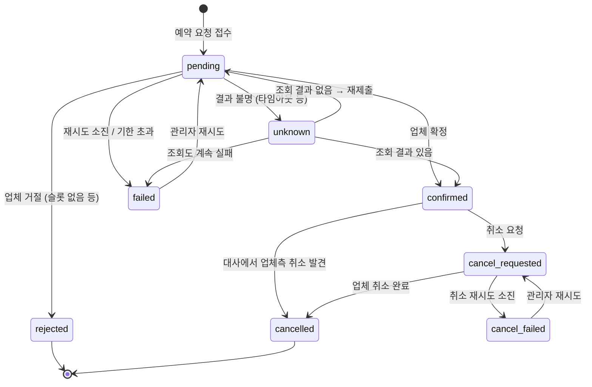

# 02. 도메인 모델과 데이터

## 1. 도메인 개념

예약 도메인은 특정 업종에 묶이지 않는 **"시간 슬롯 예약"** 모델로 잡는다. 식당, 숙소, 병원, 체험 상품이 모두 이 틀에 들어간다.

| 개념 | 설명 | 예 |
|---|---|---|
| Provider (업체) | 우리가 연동하는 외부 예약 시스템 | alpha, beta |
| Resource (자원) | 업체 안에서 예약 대상이 되는 단위 | 매장, 객실, 진료실 |
| Slot (슬롯) | 자원의 예약 가능한 시간 구간 | 2026-11-20 19:00~20:00, 잔여 3 |
| Booking (예약) | 우리 시스템의 예약 1건. 업체 예약과 1:1로 대응 | |
| Client (클라이언트) | 우리 예약 API를 호출하는 내부 서비스. API 키로 식별 | 모바일 앱 백엔드 |

자원과 슬롯의 원본은 **업체**에 있으므로 우리 DB에 저장하지 않는다. 조회할 때 업체에 묻고 짧게 캐시한다.

## 2. 예약 상태 머신



| 상태 | 의미 | 종료 상태 |
|---|---|---|
| `pending` | 접수됨. 업체 제출을 기다리거나 진행 중 | |
| `confirmed` | 업체가 확정함. `provider_booking_id`가 채워짐 | |
| `rejected` | 업체가 업무적으로 거절함 (슬롯 마감, 잘못된 요청) | ✅ |
| `unknown` | 생성 요청을 보냈지만 성공 여부를 알 수 없음 | |
| `failed` | 기술적 실패로 포기함. 관리자가 재시도할 수 있음 | 관리자 대기 |
| `cancel_requested` | 취소 요청 접수. 업체 취소 진행 중 | |
| `cancelled` | 취소 완료 | ✅ |
| `cancel_failed` | 취소 재시도 소진. 관리자 개입 필요 | 관리자 대기 |

규칙:
- 취소는 `confirmed` 상태에서만 받는다. `pending`이나 `unknown`에서 취소 요청이 오면 `409`를 돌려준다. 처리 중인 예약을 취소하면 경쟁 상태가 복잡해지므로 1차 범위에서는 뺀다.
- 상태가 바뀔 때마다 `booking_events`에 한 줄을 남긴다 (누가, 왜, 어떤 trace에서).
- 상태 변경 SQL은 항상 "현재 상태가 기대한 상태일 때만" 바꾼다: `UPDATE ... WHERE id = $1 AND status = $expected`. 바뀐 행이 0개면 다른 곳에서 먼저 바꾼 것이다 (낙관적 동시성 제어).

### Rust로 표현하기 (스케치)

```rust
#[derive(Debug, Clone, Copy, PartialEq, Eq, Serialize, Deserialize)]
#[serde(rename_all = "snake_case")]
pub enum BookingStatus {
    Pending, Confirmed, Rejected, Unknown, Failed,
    CancelRequested, Cancelled, CancelFailed,
}

/// 상태 전이를 일으키는 사건
pub enum BookingEvent {
    ProviderConfirmed { provider_booking_id: String },
    ProviderRejected { reason: RejectReason },
    OutcomeUnknown,
    GaveUp { reason: String },
    FoundAtProvider { provider_booking_id: String },
    NotFoundAtProvider,
    AdminRetry,
    CancelRequested,
    CancelConfirmed,
    CancelGaveUp,
    CancelledExternally,
}

impl BookingStatus {
    /// 허용되지 않은 전이는 Err를 돌려준다.
    /// 모든 경우를 match로 처리하므로 상태나 사건을 하나 추가하면
    /// 컴파일러가 처리가 빠진 곳을 알려 준다.
    pub fn apply(self, event: &BookingEvent) -> Result<BookingStatus, InvalidTransition> {
        todo!()
    }
}
```

상태 전이 규칙은 `domain` 크레이트에 순수 함수로 두고, DB 없이 단위 테스트로 모든 전이를 검증한다.

## 3. 멱등성 (이중 예약 방지)

멱등성은 **두 군데**에서 지킨다.

**① 클라이언트 → 우리 API**
- `POST /v1/bookings`에는 `Idempotency-Key` 헤더가 꼭 있어야 한다.
- `bookings` 테이블의 `UNIQUE (client_id, idempotency_key)` 제약으로 중복을 막는다.
- 같은 키로 다시 오면, 요청 본문 해시(`request_hash`)가 같을 때는 기존 예약을 그대로 돌려주고, 다를 때는 `422 idempotency_key_reused`를 돌려준다.

**② 우리 → 외부 업체**
- 우리 `booking.id`(UUID v7)를 업체에 보내는 참조값으로 쓴다.
- alpha처럼 `Idempotency-Key`를 지원하는 업체는 같은 키로 재시도하면 업체가 중복 생성을 막는다. 그래서 타임아웃 뒤에 재시도해도 안전하다.
- beta처럼 지원하지 않는 업체는 생성 결과가 불분명하면 **재시도하지 않는다**. `unknown`으로 두고 `external_ref`로 조회해서 확인한 뒤에만 다시 제출한다 ([03-resilience.md §5](03-resilience.md#5-결과-불명-unknown-outcome-처리)).

## 4. 데이터베이스 스키마 (초안)

모든 시각은 `timestamptz`(UTC로 저장), ID는 UUID v7(시간순으로 정렬되어 인덱스에 유리)을 쓴다.

```sql
-- 우리 API를 호출하는 내부 클라이언트
CREATE TABLE api_clients (
    id            uuid PRIMARY KEY,
    name          text NOT NULL,
    api_key_hash  text NOT NULL UNIQUE,          -- 원문은 저장하지 않음
    created_at    timestamptz NOT NULL DEFAULT now()
);

-- 외부 업체와 업체별 정책 (관리자 화면에서 편집)
CREATE TABLE providers (
    id            text PRIMARY KEY,              -- 'alpha', 'beta'
    display_name  text NOT NULL,
    adapter_kind  text NOT NULL,                 -- 'alpha_v1', 'beta_v1'
    base_url      text NOT NULL,
    enabled       boolean NOT NULL DEFAULT true,
    policy        jsonb NOT NULL,                -- 타임아웃 · 재시도 · rate limit · 서킷 설정 (03-resilience.md §3)
    updated_at    timestamptz NOT NULL DEFAULT now()
);

CREATE TABLE bookings (
    id                   uuid PRIMARY KEY,
    client_id            uuid NOT NULL REFERENCES api_clients(id),
    idempotency_key      text NOT NULL,
    request_hash         bytea NOT NULL,
    provider_id          text NOT NULL REFERENCES providers(id),
    resource_id          text NOT NULL,
    slot_start           timestamptz NOT NULL,
    party_size           int  NOT NULL CHECK (party_size > 0),
    customer             jsonb NOT NULL,         -- {name, phone}
    status               text NOT NULL,
    status_reason        text,
    provider_booking_id  text,
    deadline_at          timestamptz NOT NULL,   -- 이 시각까지 확정하지 못하면 failed
    created_at           timestamptz NOT NULL DEFAULT now(),
    updated_at           timestamptz NOT NULL DEFAULT now(),
    UNIQUE (client_id, idempotency_key)
);
CREATE INDEX bookings_status_idx   ON bookings (status, updated_at);
CREATE INDEX bookings_provider_idx ON bookings (provider_id, slot_start);

-- 상태 변경 이력 (관리자 화면의 타임라인, 감사 기록)
CREATE TABLE booking_events (
    id           bigserial PRIMARY KEY,
    booking_id   uuid NOT NULL REFERENCES bookings(id),
    from_status  text,
    to_status    text NOT NULL,
    reason       text,
    actor        text NOT NULL,                  -- 'api', 'worker', 'reconciler', 'admin:<이름>'
    trace_id     text,
    at           timestamptz NOT NULL DEFAULT now()
);
CREATE INDEX booking_events_booking_idx ON booking_events (booking_id, at);

-- 작업 큐 (Transactional Outbox 역할도 함)
CREATE TABLE jobs (
    id             bigserial PRIMARY KEY,
    kind           text NOT NULL,                -- submit_booking, resolve_unknown, cancel_booking, reconcile_provider
    booking_id     uuid REFERENCES bookings(id),
    payload        jsonb NOT NULL DEFAULT '{}',
    status         text NOT NULL DEFAULT 'queued', -- queued, running, done, dead
    attempts       int  NOT NULL DEFAULT 0,
    max_attempts   int  NOT NULL,
    run_at         timestamptz NOT NULL DEFAULT now(),
    locked_until   timestamptz,
    last_error     text,
    trace_context  jsonb,                        -- 작업을 만든 요청의 traceparent
    created_at     timestamptz NOT NULL DEFAULT now(),
    updated_at     timestamptz NOT NULL DEFAULT now()
);
CREATE INDEX jobs_ready_idx ON jobs (run_at) WHERE status = 'queued';

-- 외부 업체 호출 기록 (시도 1번 = 1행). 통계 · 분석의 원천 데이터
CREATE TABLE provider_calls (
    id                    bigserial PRIMARY KEY,
    provider_id           text NOT NULL,
    operation             text NOT NULL,         -- availability, create_booking, find_booking, cancel_booking, list_bookings
    booking_id            uuid,
    job_id                bigint,
    attempt               int  NOT NULL,         -- 호출 내 재시도 번호 (1부터)
    started_at            timestamptz NOT NULL,
    duration_ms           int  NOT NULL,
    outcome               text NOT NULL,         -- 03-resilience.md §1의 분류
    http_status           int,
    rate_limit_remaining  int,                   -- 업체 응답 헤더에서 읽은 값
    retry_after_ms        int,
    error_detail          text,
    trace_id              text
);
CREATE INDEX provider_calls_time_idx    ON provider_calls (provider_id, started_at);
CREATE INDEX provider_calls_booking_idx ON provider_calls (booking_id) WHERE booking_id IS NOT NULL;

-- 대사(reconciliation)에서 찾은 불일치
CREATE TABLE reconciliation_issues (
    id                   bigserial PRIMARY KEY,
    provider_id          text NOT NULL,
    booking_id           uuid,
    provider_booking_id  text,
    kind                 text NOT NULL,          -- missing_at_provider, missing_locally, status_mismatch, duplicate_suspected
    detail               jsonb NOT NULL,
    detected_at          timestamptz NOT NULL DEFAULT now(),
    resolved_at          timestamptz,
    resolved_by          text
);
```

관리자 인증용 `admin_users` 테이블은 Phase 6에서 추가한다.

## 5. 작업 큐 동작

별도 메시지 브로커(RabbitMQ, Kafka) 없이 PostgreSQL 테이블로 작업 큐를 만든다. → [D-03](decisions.md#d-03-예약-생성은-비동기202--postgresql-작업-큐)

**예약 접수 (한 트랜잭션)**
```sql
BEGIN;
  INSERT INTO bookings (...) ON CONFLICT (client_id, idempotency_key) DO NOTHING;
  INSERT INTO booking_events (to_status = 'pending', ...);
  INSERT INTO jobs (kind = 'submit_booking', booking_id = ..., trace_context = 현재 trace);
COMMIT;
```
예약 저장과 작업 등록이 함께 성공하거나 함께 실패하므로 "저장은 됐는데 업체에 보내지지 않은" 예약이 생기지 않는다.

**작업 가져오기** (워커가 여러 개 돌아도 같은 작업을 동시에 집지 않음)
```sql
UPDATE jobs
SET status = 'running', attempts = attempts + 1,
    locked_until = now() + interval '60 seconds', updated_at = now()
WHERE id IN (
    SELECT id FROM jobs
    WHERE (status = 'queued'  AND run_at <= now())
       OR (status = 'running' AND locked_until < now())   -- 처리 도중 죽은 워커의 작업 회수
    ORDER BY run_at
    LIMIT $1
    FOR UPDATE SKIP LOCKED
)
RETURNING *;
```

**작업 결과 처리**
| 결과 | 처리 |
|---|---|
| 성공 | `status = 'done'`, 같은 트랜잭션에서 예약 상태 전이 |
| 다시 시도할 만한 실패 | `status = 'queued'`, `run_at = now() + 백오프` |
| 업체를 호출하지 않고 미룬 경우 (서킷 열림, 업체 pause) | 위와 같지만 `attempts`를 되돌린다 (실제로 호출하지 않았으므로). 대신 예약의 `deadline_at`으로 전체 기한을 제한한다 |
| 횟수 소진 또는 기한 초과 | `status = 'dead'`, 예약을 `failed` 또는 `cancel_failed`로 전이. 관리자 화면에 표시 |

폴링 간격은 500ms로 시작한다. 지연을 더 줄이고 싶으면 나중에 PostgreSQL `LISTEN/NOTIFY`로 워커를 깨우는 방식을 더한다.

## 6. 보관 정책

| 테이블 | 보관 기간 | 방법 |
|---|---|---|
| `provider_calls` | 30일 | 매일 정리 작업이 삭제. 장기 추세가 필요하면 시간 단위 집계 테이블을 추가 (Phase 7 이후) |
| `jobs` (`done`) | 7일 | 매일 정리 |
| 나머지 | 영구 | |
