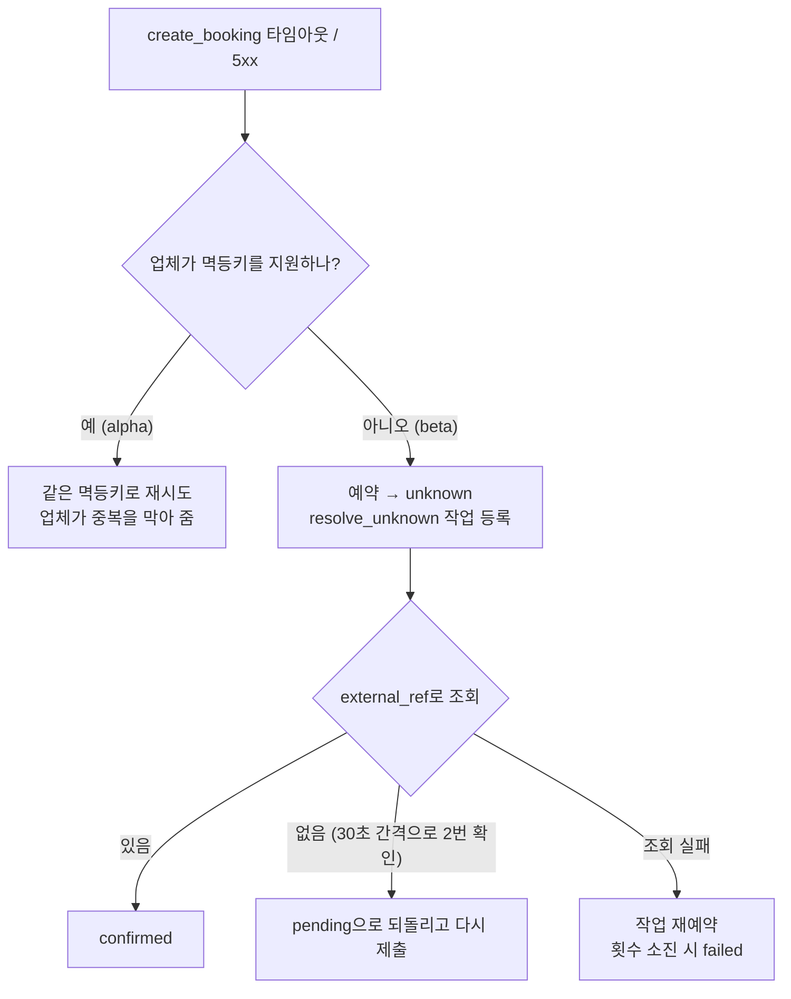
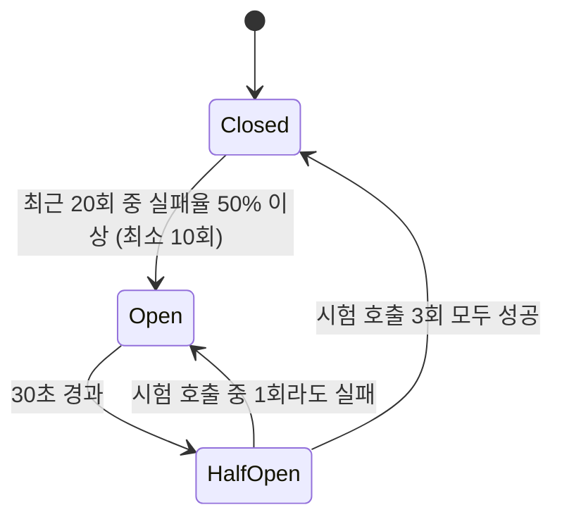

# 03. 장애 대응 설계 (Resilience)

외부 업체는 우리가 통제할 수 없다. 이 문서는 업체가 느리거나, 에러를 내거나, 호출을 제한하거나, 응답 없이 끊길 때 서비스가 어떻게 움직이는지 정한다.

지켜야 할 불변 조건:
1. **이중 예약 0건**: 업체에 같은 예약이 두 번 생기지 않는다.
2. **유실 0건**: 접수한 예약은 반드시 종료 상태나 관리자 확인 대기 상태(`failed`, `cancel_failed`)에 도달한다.
3. **격리**: 한 업체의 장애가 다른 업체 호출을 막지 않는다.

## 1. 실패 분류

어댑터는 업체 응답을 아래 enum으로 분류해서 돌려준다. 그다음의 모든 판단(재시도할지, 서킷에 실패로 셀지, 어떤 상태로 보낼지)은 이 분류만 보고 한다.

```rust
pub enum ProviderError {
    /// 응답 시간 초과. 요청이 업체에 닿았는지 알 수 없다
    Timeout,
    /// 연결 실패. 요청이 업체에 닿지 않았다
    Connect { detail: String },
    /// 요청을 보내는 중이나 응답을 받는 중에 연결이 끊김. 업체가 처리했는지 알 수 없다 (Phase 2에서 추가)
    Transport { detail: String },
    /// 업체가 호출 제한을 알림 (alpha: 429, beta: 503 + Retry-After)
    RateLimited { retry_after: Option<Duration> },
    /// 업체 서버 오류 (5xx)
    Server { status: u16 },
    /// 업무적 거절 (슬롯 마감 등). 기술적으로는 정상 응답
    Rejected { reason: RejectReason },
    /// 예상하지 못한 4xx. 대개 우리 쪽 버그
    Client { status: u16, body: String },
    /// 응답 형식이 계약과 다름
    Decode { detail: String },
    /// 서킷이 열려 있어서 호출하지 않음
    CircuitOpen { retry_at: Instant },
    /// 우리 쪽 rate limiter나 bulkhead에서 대기 한도를 넘음
    Throttled { retry_at: Instant },
}
```

| 분류 (`outcome`) | 호출 내 재시도 | 서킷 브레이커 집계 | 비고 |
|---|---|---|---|
| `success` | - | 성공 | |
| `rejected` | ❌ | 성공 | 업무적 거절은 업체가 정상이라는 뜻 |
| `timeout` | 멱등 안전할 때만 | 실패 | §5 참고 |
| `connect_error` | ✅ | 실패 | 요청이 가지 않았으므로 항상 안전 |
| `transport_error` | 멱등 안전할 때만 | 실패 | 타임아웃과 같이 결과 불명 |
| `server_error` | 멱등 안전할 때만 | 실패 | 5xx여도 업체가 처리했을 가능성이 있음 |
| `rate_limited` | Retry-After ≤ 1초일 때만 | 제외 | 업체 pause 설정 (§6) |
| `client_error` | ❌ | 제외 | 알림 대상 (우리 버그 가능성) |
| `decode_error` | ❌ | 실패 | 알림 대상 (업체 계약 변경 가능성) |
| `circuit_open` | ❌ | - | 작업 수준에서 재예약 |
| `throttled` | ❌ | - | 작업 수준에서 재예약 |

"멱등 안전"하다는 것은 조회 호출(availability, find, list)이거나, 업체가 멱등키를 지원하는 생성 · 취소 호출이라는 뜻이다.

**구현 (Phase 3)**: 분류와 분류별 판단(처리 안 됐다고 확신할 수 있는지, 서킷 집계)은 `crates/providers/src/error.rs`, 호출 내 재시도 판단은 `crates/providers/src/resilience/retry.rs`의 `may_retry`에 있다. 워커는 호출 내 재시도까지 끝난 **최종 결과**를 보고 작업 수준에서 판단한다 (`crates/booking-server/src/worker/submit.rs`의 `decide`, 조회는 `resolve.rs`의 `decide_resolution`).

| 최종 결과 | 워커의 처리 |
|---|---|
| 성공 | `confirmed` |
| `rejected` | `rejected` |
| `client_error` | 포기 (`failed`) |
| `circuit_open`, `throttled` | 시도 횟수를 쓰지 않고 미룸 (`retry_at`까지 기다린 뒤 + 무작위 0~0.5초) |
| `connect_error`, `rate_limited` | 작업 재예약 (요청이 처리되지 않았으므로 항상 안전) |
| `timeout`, `transport_error`, `server_error`, `decode_error` | 멱등키를 지원하는 업체면 작업 재예약, 아니면 `unknown` + `resolve_unknown` 작업 등록 (다시 보내지 않음) |

## 2. 파이프라인 구성

어댑터는 "HTTP ↔ 도메인 타입 변환"만 한다. 장애 대응은 어댑터를 감싸는 `ResilientProvider`가 맡는다. Polly 정책으로 HttpClient를 감싸는 것과 같은 구조다.

```
ResilientProvider::call(operation)
│
├─ [전체 시간 예산]      작업 1회당 최대 15초
└─ [재시도 루프]         최대 3회, 지수 백오프 + full jitter
    └─ 시도할 때마다:
        ├─ [업체 pause 확인] Retry-After로 쉬는 중이면 바로 Throttled
        ├─ [서킷 브레이커]   열려 있으면 바로 CircuitOpen
        ├─ [rate limiter]    토큰을 기다림 (최대 500ms, 넘으면 Throttled)
        ├─ [bulkhead]        업체별 동시 실행 수 제한 (최대 200ms 대기)
        ├─ [시도 타임아웃]   3초 (남은 예산이 더 짧으면 그만큼)
        ├─ 어댑터 호출 → 결과 분류
        └─ 기록: provider_calls, 메트릭, 서킷 상태 갱신, 429면 업체 pause
```

Polly가 권장하는 순서(Retry → CircuitBreaker → Timeout)와 같은 이유로 이 순서를 쓴다. 재시도가 가장 바깥에 있어야 시도마다 서킷과 타임아웃을 따로 거친다.

**구현 메모** (`crates/providers/src/resilience/`)
- 업체 pause는 호출을 시작할 때뿐 아니라 **시도마다** 확인한다. 한 호출이 재시도를 기다리는 동안 다른 호출이 429를 받아 pause가 걸릴 수 있기 때문이다.
- 관문(pause · 서킷 · rate limiter · bulkhead)에서 막힌 시도도 `provider_calls`에 `circuit_open` / `throttled`로 남긴다. 실제로 부르지 않았으므로 지연 통계에서는 뺀다 ([05 §7](05-observability-and-analytics.md#7-분석-쿼리-관리자-통계-api의-기반)).
- 재시도 대기 시간은 `max(백오프, Retry-After)`다. 대기 뒤 **시도 타임아웃만큼 온전히 쓸 예산이 남지 않으면** 재시도하지 않고 마지막 실패를 돌려준다 (남은 몇 ms로 보낸 요청은 거의 타임아웃이 나고, 멱등키 없는 업체에서는 괜히 결과 불명이 된다). 관문에서 기다리다 예산을 다 쓰면 업체를 부르지 않고 `Throttled`로 돌려준다.
- 재시도가 관문에서 막혔는데 앞선 시도가 업체까지 갔다면, `CircuitOpen` · `Throttled` 대신 **앞선 시도의 실패**를 돌려준다. 워커는 관문에서 막힌 실패를 "부르지 않았다"로 보고 시도 횟수를 되돌리는데, 실제로 부른 호출까지 되돌리면 업체가 계속 죽어 있을 때 작업이 끝없이 미뤄진다.
- 서킷 허락은 rate limiter · bulkhead를 기다리기 전에 받으므로, 기다린 뒤 허락이 아직 유효한지(그사이 서킷이 열리지 않았는지) 다시 확인한다. 또 서킷 · pause에 결과를 반영한 **뒤에** bulkhead 자리를 반납해서, 자리를 기다리던 다음 호출이 그 결과를 보고 판단하게 한다.
- 호출 한 번은 최대 `call_budget_ms + rate_limit.max_wait_ms + bulkhead.max_wait_ms`가 걸린다. 워커의 lease가 이보다 짧으면 호출 도중 다른 워커가 같은 작업을 다시 가져가므로, 서버가 시작할 때 lease가 이 값 + 5초 이상인지 검사하고 아니면 시작하지 않는다.
- 업체가 처리했을지 모르는 실패 뒤에는 멱등 안전할 때만 다시 보낸다. 그래서 멱등키 없는 업체의 생성 요청은 한 호출 안에서 두 번 나가지 않고, 그 실패가 그대로 워커에 전달된다.
- 어댑터는 결과와 함께 응답 메타(HTTP 상태, `X-RateLimit-Remaining`)를 돌려준다. `ResilientProvider`가 메타는 호출 기록에 쓰고 결과만 바깥에 넘긴다 ([D-17](decisions.md#d-17-어댑터는-결과와-함께-응답-메타를-돌려준다)).
- 메트릭은 Phase 4에서 붙인다. 지금은 로그와 `provider_calls`로 확인한다.

## 3. 업체별 정책 (기본값)

`providers.policy`(jsonb)에 저장한다. 관리자 화면에서 바꾸면 재시작 없이 반영된다(arc-swap으로 교체).

```json
{
  "attempt_timeout_ms": 3000,
  "call_budget_ms": 15000,
  "retry":           { "max_attempts": 3, "base_delay_ms": 200, "max_delay_ms": 2000 },
  "rate_limit":      { "per_second": 10, "burst": 5, "max_wait_ms": 500 },
  "bulkhead":        { "max_concurrency": 8, "max_wait_ms": 200 },
  "circuit_breaker": { "window": 20, "min_calls": 10, "failure_rate": 0.5,
                       "open_ms": 30000, "half_open_probes": 3 },
  "availability_cache_ttl_ms": 30000
}
```

## 4. 두 단계 재시도

| 단계 | 담당 | 간격 | 횟수 | 다루는 실패 |
|---|---|---|---|---|
| 호출 내 재시도 | ResilientProvider | 200ms → 최대 2초 (jitter) | 3회 | 짧은 일시 오류 (연결 끊김, 순간적인 5xx) |
| 작업 재예약 | 워커 | 5초 → 최대 10분 (지수 + jitter) | 8회 | 호출 내 재시도 소진, 서킷 열림, 업체 pause |

- 서킷 열림이나 pause 때문에 **호출하지 않고** 미룬 경우는 작업 시도 횟수로 세지 않는다. 대신 예약의 `deadline_at`(기본값: 접수 후 30분, 단 슬롯 시작 시각을 넘지 않음)이 지나면 `failed`로 끝낸다.
- 백오프 공식 (full jitter): `delay = random(0, min(max_delay, base × 2^(attempt-1)))`
- 구현: 호출 내 재시도는 `providers::resilience::backoff_delay`(full jitter), 작업 재예약은 `booking_server::worker::JobBackoff`(상한의 절반은 고정 + 절반은 무작위인 equal jitter). 미룬 작업은 `db::jobs::defer`가 `attempts`를 1 되돌린다.

## 5. 결과 불명 (unknown outcome) 처리

가장 위험한 경우는 예약 생성 요청을 보냈는데 타임아웃이 난 상황이다. 업체에 예약이 **생겼을 수도, 안 생겼을 수도** 있다.



"없음"을 한 번만 보고 다시 제출하지 않는 이유는, 업체 내부 처리가 늦어서 조회에 아직 안 보일 수 있기 때문이다. 두 번 확인해서 잘못된 판단을 줄인다.

어댑터는 자신이 할 수 있는 일을 선언한다.
```rust
pub struct Capabilities {
    pub idempotency_key: bool,     // 생성 · 취소에 멱등키 지원
    pub lookup_by_reference: bool, // 우리 참조값으로 예약 조회 가능
    pub list_bookings: bool,       // 기간별 예약 목록 (대사용)
}
```
멱등키도 참조값 조회도 지원하지 않는 업체는, 결과 불명이 생기면 자동으로 다시 제출하지 않고 바로 관리자 확인 대상으로 넘긴다.

**구현 (Phase 3)**: `crates/booking-server/src/worker/resolve.rs`
- 예약이 `unknown`이 되는 트랜잭션에서 `resolve_unknown` 작업을 함께 등록하고, `unknown → pending`이 되는 트랜잭션에서는 `submit_booking` 작업을 등록한다. "상태에 들어가면 그 상태를 처리할 작업을 같은 트랜잭션에 등록한다"는 규칙 하나로 처리한다 (`worker::follow_up`).
- "없음"을 확인한 횟수는 작업의 `payload`(`{"not_found_checks": 1}`)에 남긴다. 두 번째 확인까지 기다리는 시간은 `BOOKING_WORKER_UNKNOWN_RECHECK_SECS`(기본 30초).
- 업체에 같은 참조값의 예약이 있어도 **취소된 것**뿐이면 "없음"으로 본다. 다시 만들어도 이중 예약이 아니기 때문이다.
- 참조값 조회를 지원하지 않는 업체는 조회하지 않고 바로 `failed`(사유 `unresolved_unknown: ...`)로 보낸다. 조회가 `client_error`로 실패해도 같다.
- 조회 실패는 작업 재예약(시도 횟수 사용)이고, 소진되면 `failed`. 서킷 · pause로 막히면 시도 횟수를 쓰지 않고 미룬다.
- `unknown`에서 `failed`가 된 예약은 업체에 실제로 있을 수 있다. 관리자 재시도(Phase 5)는 다시 제출하기 전에 업체 조회를 먼저 하게 만들어야 한다.
- alpha는 멱등키를 지원하므로 실제로는 `unknown`이 되지 않는다. 이 경로는 멱등키 없는 업체를 메모리로 흉내 내 시나리오 테스트로 검증한다 (beta 어댑터는 Phase 6).
- **알려진 한계 (Phase 6에서 해결)**: 워커가 멱등키 없는 업체에 생성 요청을 보낸 직후, 결과를 저장하기 전에 죽으면(또는 그 저장이 DB 오류로 실패하면) lease가 만료된 뒤 다른 워커가 같은 예약을 **다시 보낸다**. 멱등키가 있는 alpha는 업체가 중복을 막아 주므로 문제가 없고, 지금은 멱등키 없는 업체가 없다. beta를 붙이기 전에 "보내기 직전에 작업에 '보냄' 표시를 커밋하고, 그 표시가 있는 작업을 다시 가져가면 보내지 않고 `unknown`으로 넘긴다"를 만든다.

## 6. Rate limit 관리

| 단계 | 방법 | 목적 |
|---|---|---|
| ① 우리가 먼저 제한 | governor (GCRA 토큰 버킷), 업체별 | 429를 아예 받지 않도록 |
| ② 업체 신호 따르기 | 429/503의 `Retry-After` → 업체 전체 **pause** (그동안 그 업체 호출 중단) | 업체에 추가 부하를 주지 않음 |
| ③ 여유량 관찰 | `X-RateLimit-Remaining` 헤더를 기록하고 메트릭으로 노출 | 관리자 화면에서 쿼터 여유 확인 |
| ④ 적응형 조절 (Phase 6) | 429를 받으면 허용 속도를 절반으로, 한동안 문제없으면 조금씩 회복 (AIMD) | 업체 한도를 몰라도 자동으로 맞춤 |

업체 한도는 여러 작업이 나눠 쓰는 자원이다. 사용자가 기다리는 조회(availability)가 백그라운드 작업(대사)에 밀리지 않도록, 대사 작업은 토큰이 50% 넘게 남아 있을 때만 호출한다 (Phase 6).

## 7. 서킷 브레이커



- 업체마다 하나씩 프로세스 메모리에 둔다.
- 상태가 바뀔 때마다 로그, 메트릭, 업체 런타임 상태 API에 반영한다.
- 관리자가 강제로 열고 닫을 수 있다 (업체 점검 공지에 대응).
- 학습을 위해 라이브러리 대신 직접 구현한다. → [D-05](decisions.md#d-05-장애-대응은-작은-부품을-조합하고-서킷-브레이커와-재시도는-직접-구현)

**구현 (Phase 3)**: `crates/providers/src/resilience/circuit.rs`. 현재 시각을 인자로 받는 순수 상태 머신이라 실제로 기다리지 않고 모든 전이를 단위 테스트한다. 여러 태스크가 함께 쓰도록 잠그는 일은 `ResilientProvider`가 한다.
- 실패율은 최근 `window`회의 **집계 대상** 결과로 계산한다. `rate_limited`, `client_error`처럼 업체 건강과 상관없는 결과는 세지 않는다 (§1 표).
- 반만 열린 상태에서 시험 호출 자리가 모두 나가 있으면 `CircuitOpen`을 돌려준다 (다시 와 볼 시각: 1초 뒤, `open_ms`가 더 짧으면 그만큼). 시험 호출이 관문(rate limiter 등)에서 막혀 부르지 못하면 자리를 돌려받는다.
- 시험 호출이 모두 나간 채 `open_ms`가 지나도록 결과가 다 돌아오지 않으면(호출이 취소되거나 패닉한 경우) 시험을 처음부터 다시 시작한다. 그러지 않으면 시험 자리가 영영 막혀 서버를 다시 띄울 때까지 그 업체를 부를 수 없다.
- 호출 허락에 "상태 세대"를 붙인다. 다른 상태일 때 시작한 호출의 늦은 결과는 집계하지 않는다 (예: Closed일 때 나간 느린 호출의 성공이 Half-Open의 시험 호출 성공으로 잘못 세지지 않게).
- 상태가 바뀌면 로그를 남긴다. 메트릭(Phase 4), 런타임 상태 API와 강제 열기 · 닫기(Phase 5)는 아직 없다.

## 8. Bulkhead (격리)

업체마다 `tokio::sync::Semaphore`를 하나씩 두고 동시 호출 수를 제한한다. alpha가 느려져 호출이 쌓여도 beta 쪽 자원은 그대로 남는다. 워커도 업체별 동시 처리 수를 같은 값으로 제한한다.

**Phase 3 구현 상태**: 업체별 Semaphore는 구현했다 (`max_wait_ms` 안에 자리가 나지 않으면 `Throttled` → 작업 미루기). 워커의 업체별 동시 처리 제한은 두 번째 업체를 추가하는 Phase 6에서 만든다 ([D-19](decisions.md#d-19-워커의-업체별-동시-처리-제한은-두-번째-업체phase-6와-함께-만든다)).

## 9. 대사 (Reconciliation)

정기 작업(`reconcile_provider`, 업체마다 10분 간격)이 최근 24시간 슬롯의 예약을 업체 목록과 비교한다.

| 발견한 것 | 처리 |
|---|---|
| 우리는 `confirmed`, 업체에서는 취소됨 | 예약 → `cancelled` (actor: reconciler), 이슈 기록 |
| 우리는 `confirmed`, 업체에는 없음 | 이슈 기록 (자동 처리하지 않음) |
| 우리 참조값을 단 예약이 업체에 2건 이상 | 이슈 기록 (이중 예약 의심, 긴급 알림) |
| 우리는 `failed`/`unknown`, 업체에서는 확정됨 | 이슈 기록, 예약 → `confirmed` |

## 10. 장애 시나리오와 기대 동작

mock-provider의 장애 주입으로 아래 시나리오를 자동화된 통합 테스트로 만든다. 모든 시나리오에서 **"업체에 같은 참조값의 예약이 2건 이상 없다"**를 검사한다.

| 시나리오 | mock 설정 | 기대 동작 |
|---|---|---|
| 정상 | `healthy` | 모두 `confirmed`, p95 < 300ms |
| 간헐적 5xx | 오류율 10% | 호출 내 재시도로 흡수. 재시도 메트릭은 늘지만 최종적으로 모두 `confirmed` |
| 지연 폭증 | 지연 2~5초 | 타임아웃 → 재시도 → 서킷 Open → 작업 재예약. 회복되면 Half-Open → Closed, 밀린 예약 처리 |
| 호출 제한 | 초당 5회 | 우리 limiter가 대부분 막음. 429가 오면 pause했다가 재개 |
| 커밋 후 응답 유실 | 유실 확률 20% | alpha: 같은 멱등키로 재시도해서 중복 없음. beta: `unknown` → 조회 → `confirmed` |
| 완전 장애 | `outage` | 서킷 Open, 예약은 `pending`으로 유지. 복구되면 자동 처리, 기한이 지나면 `failed` |
| 업체측 취소 | `/_inspect`로 임의 취소 | 대사 작업이 찾아내서 `cancelled`, 이슈 기록 |
| 한 업체만 장애 | alpha만 `outage` | beta 예약의 처리량과 지연에 영향 없음 (격리) |

**자동화 상태 (Phase 3)**: `crates/booking-server/tests/scenarios.rs`. 예약 API → 워커 → `ResilientProvider` → alpha 어댑터 → mock 업체와 호출 기록 태스크까지 실제 구성으로 돌린다. 테스트 시간을 줄이려고 시간 값을 줄여서 쓴다 (시도 타임아웃 300ms, 서킷 open 500ms, 느린 응답 1초 등).

| 시나리오 | 테스트 | 검사하는 것 (모두 이중 예약 0건 포함) |
|---|---|---|
| 정상 | `정상_업체에서는_모두_확정되고_429를_받지_않는다` | 모두 `confirmed`, 우리 limiter가 업체 한도 안에서 호출해 429 없음 |
| 간헐적 5xx | `간헐적_5xx는_호출_내_재시도로_흡수한다` | 5xx 30%에서도 모두 `confirmed`, 호출 내 재시도 발생 |
| 지연 폭증 | `응답이_느려지면_서킷이_열리고_회복되면_닫힌다` | 서킷 Open 동안 `pending` 유지 → 회복 후 모두 `confirmed`, 서킷 Closed |
| 호출 제한 | `업체_한도보다_낮게_호출하면_429_없이_모두_처리된다`, `업체가_429를_보내면_pause했다가_재개한다` | 우리 limiter가 막아 429 없음 / 429를 받으면 pause(`throttled` 기록) 후 재개 |
| 커밋 후 응답 유실 | `응답이_유실되어도_같은_멱등키로_재시도해_이중_예약이_없다`, `멱등키가_없는_업체는_결과_불명을_조회로_확인해_이중_예약이_없다` | alpha: 같은 멱등키 재시도 / 멱등키 없는 업체(메모리로 흉내): `unknown` → 조회 → `confirmed` 또는 다시 제출 |
| 완전 장애 | `업체가_멈추면_예약을_보류하고_기한이_지난_것만_실패시킨다` | 장애 중 `pending` 유지, 기한이 지난 예약만 `failed`, 복구 후 나머지 `confirmed` |
| 업체측 취소 | (Phase 6) | 대사 작업과 함께 |
| 한 업체만 장애 | (Phase 6) | 두 번째 업체와 함께 |
