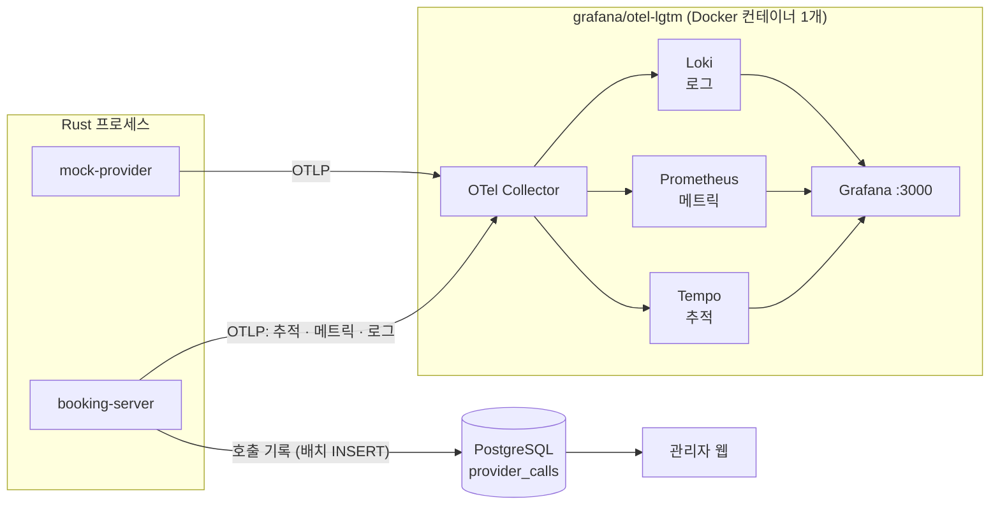

# 05. 관측과 분석

## 1. 전체 구성



- 앱은 **OpenTelemetry(OTLP)로만** 내보낸다. 받는 쪽을 Datadog이나 OpenObserve 등으로 바꿔도 코드는 그대로다 (`OTEL_EXPORTER_OTLP_ENDPOINT`만 바꾸면 됨). → [D-06](decisions.md#d-06-관측은-opentelemetryotlp-단일-경로-로컬은-grafanaotel-lgtm)
- 로컬 개발 중에는 사람이 읽기 쉬운 형식으로 콘솔에도 로그를 출력한다.

**구현 (Phase 4)**: `crates/telemetry`

```text
tracing 매크로 (info!, #[instrument] …)
   ├─▶ 콘솔 로그 (stderr)
   ├─▶ span  ──▶ OpenTelemetry 추적 ─┐
   └─▶ event ──▶ OpenTelemetry 로그 ─┼─ OTLP (HTTP + protobuf) ─▶ 수집기 :4318
계측기 (Counter, Histogram, Gauge) ──┘
```

- 코드에서는 `tracing` 매크로와 OpenTelemetry **계측기 API**만 쓴다. 어디로 내보낼지는 실행 파일이 시작할 때 `telemetry::init`으로 한 번 정한다 (≈ .NET에서 코드는 `ILogger` · `Activity` · `Meter`만 쓰고, 내보내기는 `AddOpenTelemetry()`로 구성하는 것). 라이브러리 크레이트(`providers`)는 SDK에 의존하지 않는다. → [D-20](decisions.md#d-20-라이브러리-크레이트는-opentelemetry-api만-쓰고-sdk-구성은-telemetry-크레이트에만-둔다)
- 전송은 OTLP/HTTP(protobuf)다. 내보내기는 SDK가 만든 **전용 스레드**가 한다 (추적 5초, 로그 1초, 메트릭 10초마다). 요청을 처리하는 태스크는 메모리 큐에 넣기만 하므로, 수집기가 느리거나 죽어 있어도 서비스는 느려지지 않는다. 큐가 가득 차면 버린다. → [D-21](decisions.md#d-21-otlp는-httpprotobuf로-보내고-내보내기는-sdk의-전용-스레드에-맡긴다)
- `telemetry::init`이 돌려주는 값(`Telemetry`)을 `main`이 끝날 때까지 들고 있는다. 그 값이 사라질 때 아직 보내지 않은 데이터를 마저 내보낸다.
- `booking-server serve`와 `mock-provider`만 내보낸다. `create-client`처럼 금방 끝나는 명령은 콘솔 로그만 쓴다.
- 내보내기를 꺼도(`OTEL_SDK_DISABLED=true`) trace ID는 만든다. 그래서 응답 헤더 · 로그 · DB에 남는 trace ID는 그대로다.

| 환경 변수 | 뜻 | 기본값 |
|---|---|---|
| `OTEL_EXPORTER_OTLP_ENDPOINT` | 수집기 주소 (OTLP/HTTP) | `http://localhost:4318` |
| `OTEL_SDK_DISABLED` | `true`면 내보내지 않는다 | `false` |
| `OTEL_METRIC_EXPORT_INTERVAL` | 메트릭을 내보내는 간격 (밀리초) | `10000` |
| `RUST_LOG` | 로그 필터. 콘솔 로그와 내보내는 로그에 함께 적용된다 | 서버: `info,booking_server=debug,providers=debug,telemetry=debug,sqlx=warn` |
| `LOG_FORMAT` | `json`이면 콘솔 로그를 JSON으로 | 한 줄 형식 |

로그 필터는 **전역**으로 건다 (`telemetry::filter`). → [D-22](decisions.md#d-22-로그-필터는-전역으로-걸고-per-layer-filter는-tokio-console-모드에서만-쓴다)
- **이벤트(로그)는 `RUST_LOG`를 따른다.** 걸러진 로그는 콘솔에도 Loki에도 가지 않으므로, 콘솔에 찍히는 로그와 Grafana로 가는 로그가 항상 같다.
- **span은 info 이상이면 `RUST_LOG`와 상관없이 만든다.** 로그를 줄이려고 `RUST_LOG=warn`으로 올려도 추적, 응답의 `X-Trace-Id`, DB에 남는 trace ID는 그대로다. "로그를 얼마나 자세히 볼지"와 "추적을 할지"는 따로 정한다.
- 로그를 내보내는 과정에서 생긴 로그(exporter의 HTTP 클라이언트와 OpenTelemetry 자신의 로그)는 Loki로 보내지 않는다. 보내면 내보낼 때마다 로그가 또 생겨 끝없이 되먹임된다 (`RUST_LOG=debug`에서 드러난다). 콘솔에는 그대로 나온다.

알아 둘 한계: 같은 서비스의 프로세스를 서로 구분하는 속성(`service.instance.id`)은 넣지 않았다. 지금은 서비스마다 프로세스가 하나다. API와 워커를 따로 띄우거나(`--role`) 여러 대로 늘리면 같은 시계열에 여러 프로세스가 쓰게 되므로, 그때 추가하고 대시보드의 gauge 질의를 프로세스별로 묶는다.

## 2. 데이터 두 갈래: 메트릭과 호출 기록

| | 메트릭 (Prometheus) | 호출 기록 (`provider_calls`) |
|---|---|---|
| 용도 | 실시간 대시보드, 알림 | 관리자 화면 분석, 예약별 추적 |
| 저장 | 집계값 (히스토그램 버킷) | 호출 1회 = 1행 |
| p95 | **근사값** (버킷 경계로 보간) | **정확한 값** (`percentile_cont`) |
| 조건 | 라벨(업체 · 작업 · 결과)로만 | SQL로 무엇이든 (예약별, 시도 번호별, 특정 시간대) |
| 비용 | 아주 적음 | 행 수만큼 저장 공간 |

두 p95를 나란히 비교하면 히스토그램 버킷 설계가 p95 정확도에 얼마나 영향을 주는지 직접 확인할 수 있다.

## 3. 추적 (Traces)

span 구조:
```
POST /v1/bookings                                  [http server]
└─ booking.accept  booking_id=…
   └─ db: INSERT bookings / jobs

(jobs.trace_context로 연결 — span link)

job.submit_booking  job_id=… booking_id=…          [새 trace, 위 trace를 link로 가리킴]
└─ provider.call  provider=alpha operation=create_booking
   ├─ provider.attempt  attempt=1 outcome=timeout
   │  └─ HTTP POST /alpha/v1/reservations           [http client, traceparent 전파]
   │     └─ (mock-provider) POST /alpha/v1/reservations
   └─ provider.attempt  attempt=2 outcome=success
      └─ HTTP POST …
```

- **HTTP 전파**: 업체 호출에 W3C `traceparent` 헤더를 붙인다. mock-provider도 계측되어 있으므로 업체 내부 지연까지 한 trace에서 보인다.
- **작업 큐 전파**: 작업은 몇 분 뒤에 실행될 수도 있으므로 같은 trace에 이어 붙이지 않고 **span link**로 연결한다 (OpenTelemetry가 비동기 메시징에 권장하는 방식).
- 모든 span에 `booking_id`를 속성으로 넣어서 예약 ID로 검색할 수 있게 한다.
- 관리자 웹 예약 상세에서 `trace_id`를 누르면 Grafana(Tempo) 화면으로 이동한다.

**구현 (Phase 4)**: 실제로 만들어지는 span (들여쓰기 = 부모 · 자식)

```
POST /v1/bookings                          [server]   telemetry::HttpTelemetryLayer
├─ db.clients.find_by_key_hash                        API 키 인증
└─ booking.accept  booking_id provider                api::bookings::create
   ├─ db.providers.find
   └─ db.bookings.accept
      └─ db.jobs.enqueue                              jobs.trace_context에 이 trace를 저장

job.submit_booking  job_id booking_id attempt decision    [새 trace, 위 trace로 link]  worker::process
├─ db.bookings.get
├─ provider.call  provider operation booking_id       ResilientProvider::call
│  ├─ provider.attempt  attempt=1 outcome=timeout     시도마다 하나. 관문에서 막힌 시도도 남는다
│  │  └─ POST /reservations                [client]   providers::trace::send (traceparent를 넣는 곳)
│  │     └─ POST /alpha/v1/reservations    [server]   mock-provider (같은 미들웨어)
│  │        └─ chaos.delay  latency_ms=3072           주입한 지연
│  └─ provider.attempt  attempt=2 outcome=success
└─ db.jobs.complete, db.bookings.transition           (재예약이면 db.jobs.retry_later 등)
```

| 무엇 | 어디서 | 메모 |
|---|---|---|
| 서버 span, `traceparent` 읽기, `X-Trace-Id` 응답 헤더 | `telemetry::HttpTelemetryLayer` (tower `Layer`) | booking-server와 mock-provider가 함께 쓴다. 헤더가 있으면 그 trace에 이어 붙고, 없으면 새 trace를 시작한다 |
| `traceparent` 쓰기 | `providers::trace::send` | 클라이언트 span 안에서 헤더를 넣으므로, 업체 쪽 span이 그 아래에 달린다 |
| 작업 큐 link | `booking_server::trace` | 접수할 때 `jobs.trace_context`에 `{"traceparent": …}`를 저장하고, 워커가 작업 span에 link로 건다. 작업이 등록한 다음 작업(`resolve_unknown` 등)도 같은 방식으로 앞 작업의 trace를 가리킨다 |
| DB에 남기는 trace ID | `booking_events.trace_id`, `provider_calls.trace_id` | 그 변경 · 호출이 일어난 trace. 접수는 요청의 trace, 확정은 작업의 trace가 남는다 |
| 오류 본문의 `trace_id` | `api::error` | 응답 헤더 `X-Trace-Id`와 같은 값 ([04 §1](04-api.md#1-공통-규약)) |

- span 이름은 값의 종류가 한정되게 짓는다 (`POST /v1/bookings/{id}`처럼 라우트 틀을 쓴다). 예약 ID 같은 값은 이름이 아니라 속성에 넣는다. Tempo가 span 이름별 지표를 만들기 때문에, 이름이 끝없이 늘어나면 메트릭 저장소가 감당하지 못한다.
- 핸들러와 DB 함수에는 `#[tracing::instrument(skip_all)]`을 쓴다. `skip_all`을 빼면 인자(고객 이름 · 전화번호가 든 요청 본문)가 span에 기록된다. 통합 테스트가 span 속성에 고객 정보가 없는지 검사한다.
- 워커가 할 일이 없을 때도 계속 부르는 `db::jobs::claim_next`에는 span을 열지 않는다 (빈 trace가 초당 여러 개씩 쌓인다). 헬스 체크(`/healthz`, `/readyz`)도 계측하지 않는다. → [D-24](decisions.md#d-24-헬스-체크-요청은-추적과-지표에서-뺀다)
- 실패는 span 상태로 표시한다: 5xx 응답(서버 span), 4xx · 5xx · 전송 오류(클라이언트 span), 거절이 아닌 실패(`provider.attempt`, `provider.call`), 포기한 작업(`job.*`). Grafana에서 `status = error`로 골라 볼 수 있다.
- **응답 전에 버려진 요청**도 남긴다. 시도 타임아웃은 기다리던 Future를 그 자리에서 버리므로 "응답을 받은 뒤 기록"하는 코드는 실행되지 않는다. 그래서 버려질 때 할 일을 `Drop`에 두었다: 우리 쪽 client span에는 `error.type=cancelled`, 업체 쪽 server span에는 `error.type=no_response`(호출한 쪽이 먼저 끊음)가 붙고 둘 다 오류로 표시된다.
- 업체가 보낸 글자(예상하지 못한 4xx의 본문, 응답 형식 오류의 내용)는 span · 로그에 넣지 않는다 (§5).
- 작업 span의 `decision` 속성에 그 실행의 결론이 남는다: `transition`, `retry`, `defer`, `recheck`, `give_up`, `skip`, `bury`.

Grafana(Explore → Tempo)에서 찾는 법:
```
{ span.booking_id = "01a1c619-…" }                                          예약 하나의 모든 trace
{ name = "provider.attempt" && duration > 500ms }                           느린 업체 호출
{ resource.service.name = "booking-server" && name =~ "job.*" && status = error }   포기한 작업
```

## 4. 메트릭 목록

이름은 OpenTelemetry 표기(점으로 구분)다. Prometheus에서는 `_`로 바뀌고 단위 접미사가 붙는다 (예: `provider.call.duration` → `provider_call_duration_seconds_bucket` / `_count` / `_sum`, counter는 `_total`).

| 이름 | 종류 | 라벨 | 설명 | 기록하는 곳 |
|---|---|---|---|---|
| `http.server.request.duration` | histogram (s) | `http.route`, `http.request.method`, `http.response.status_code` (응답하지 못했으면 대신 `error.type="no_response"`) | 우리 API 응답 시간 (mock-provider도 같은 이름으로 기록) | `telemetry::HttpTelemetryLayer` |
| `provider.call.duration` | histogram (s) | provider, operation, outcome | 업체 호출 1회(시도) 시간 | `providers::metrics` |
| `provider.call.retries` | counter | provider, operation | 호출 내 재시도 횟수 | 〃 |
| `provider.throttled` | counter | provider, source=`local`\|`remote` | 우리 limiter 대기 초과 · pause 중 / 업체 429 · 503 | 〃 |
| `provider_calls.recorder.dropped` | counter | | 호출 기록 버퍼가 가득 차서 버린 건수 | 〃 |
| `provider.rate_limit.remaining` | gauge | provider | 업체가 알려 준 남은 호출 수 | `booking_server::metrics` (업체 파이프라인의 현재 상태를 읽음) |
| `provider.paused` | gauge (0/1) | provider | Retry-After로 쉬는 중 | 〃 |
| `provider.circuit.state` | gauge (0=closed, 1=half_open, 2=open) | provider | | 〃 |
| `provider.bulkhead.in_flight` | gauge | provider | 동시에 실행 중인 호출 수 | 〃 |
| `booking.transitions` | counter | provider, from, to | 상태 전이. 접수는 `from="none"` | `booking_server::metrics` |
| `booking.time_to_final` | histogram (s) | provider, final_status | 접수부터 제출 흐름이 끝나는 상태(`confirmed` · `rejected` · `failed`)까지 걸린 시간 | 〃 |
| `booking.unknown.oldest_age` | gauge (s) | | 결과 불명 상태로 가장 오래 머문 예약의 경과 시간 (없으면 0) | 〃 (5초마다 DB 조회) |
| `jobs.ready` | gauge | kind | 실행 대기 작업 수 | 〃 (5초마다 DB 조회) |
| `jobs.dead` | gauge | kind | dead 작업 수 | 〃 (5초마다 DB 조회) |
| `jobs.lag` | histogram (s) | kind | `run_at`부터 실제 시작까지의 지연 | 〃 |
| `tokio.runtime.workers` · `alive_tasks` · `global_queue_depth` | gauge | | tokio 런타임 상태 | `telemetry::register_runtime_metrics` |

모든 지표에는 서비스 이름이 함께 붙는다 (Prometheus의 `job` 라벨: `booking-server`, `mock-provider`).

**히스토그램 버킷(초)**. OpenTelemetry 기본 버킷은 밀리초 기준이라 초 단위와 맞지 않으므로 반드시 직접 지정한다 (통합 테스트가 경계를 검사한다).

| 대상 | 경계 |
|---|---|
| `http.server.request.duration`, `provider.call.duration` | `0.005, 0.01, 0.025, 0.05, 0.1, 0.25, 0.5, 1, 2.5, 5, 10` |
| `booking.time_to_final`, `jobs.lag` | 위 경계 + `30, 60, 120, 300, 600, 1800` |

뒤의 둘은 재시도 · 장애가 끼면 몇 분이 된다. 버킷이 10초에서 끝나면 그 위가 모두 한 칸에 들어가 "작업 지연 p95가 30초 초과" 같은 알림을 계산할 수 없다. → [D-23](decisions.md#d-23-알림을-계산할-수-있도록-지표를-보완한다-긴-버킷-bookingunknownoldest_age)

**라벨 원칙**: `booking_id`처럼 값이 끝없이 늘어나는 것은 라벨로 쓰지 않는다 (메트릭 저장소가 폭발한다). 그런 값은 추적 속성이나 로그에 넣는다. HTTP 라벨의 `http.route`는 실제 경로가 아니라 라우트 틀(`/v1/bookings/{id}`)이고, 맞는 라우트가 없는 요청(404)에는 붙이지 않는다. 표준이 아닌 HTTP 메서드는 `_OTHER`로 묶는다.

**구현 메모 (Phase 4)**
- HTTP 지표의 라벨 이름은 OpenTelemetry의 HTTP 규약을 따른다 (`route`, `method`, `status` 대신 위 표의 이름). Prometheus에서는 `http_route`, `http_request_method`, `http_response_status_code`다.
- 응답을 보내기 전에 끝난 요청(호출한 쪽이 기다리다 끊은 경우)도 걸린 시간을 기록한다. 상태 코드가 없으므로 `error.type="no_response"`를 붙인다. 이것을 빼면 "너무 느려서 상대가 포기한 요청"이 지연 통계에서 사라져, mock-provider의 p95가 `slow` 프리셋에서 실제보다 빨라 보인다.
- `provider.call.duration`에는 관문에서 막혀 업체를 부르지 않은 시도(`circuit_open`, `throttled`)도 기록한다. 결과별 비율을 한 지표로 보기 위해서다. 이런 시도는 0초에 가까우므로 **지연 분위수 · 호출 수 · 성공률을 계산할 때는 `outcome!~"circuit_open|throttled"`로 뺀다** (§7의 호출 기록 분석과 같은 규칙).
- 업체 상태 지표 4개(`provider.circuit.state` 등)는 **관측형(observable)** gauge다. 값을 바뀔 때 기록하지 않고, 지표를 내보낼 때마다 SDK가 콜백으로 현재 값을 읽어 간다. pause처럼 시간이 지나면 저절로 풀리는 상태는 바뀌는 순간을 잡을 수 없기 때문이다. 콜백은 업체 레지스트리를 약한 참조(`Weak`)로 쥔다. 강한 참조로 쥐면 호출 기록 채널이 닫히지 않아 서버가 종료되지 못한다 ([D-18](decisions.md#d-18-호출-기록은-providers가-채널로-보내고-db-저장은-booking-server가-맡는다)).
- 서킷은 Open → Half-Open을 "다음 호출이 올 때" 바꾼다. 처리할 예약이 없으면 `open_ms`가 지나도 지표는 2(Open)로 남는다.
- `jobs.ready` · `jobs.dead` · `booking.unknown.oldest_age`는 DB에 물어야 아는 값이라, 워커 역할의 서버가 5초마다 조회해 갱신한다 (`metrics::run_queue_gauges`). 작업이 하나도 없는 종류도 0으로 내보낸다. 이 코드가 모르는 종류의 작업(다른 버전이 등록한 것)은 `kind="unknown"`으로 묶는다. 워커는 그런 작업을 dead로 묻으므로, 빼 버리면 "dead 작업이 있음" 알림이 울리지 않는다. dead 작업 조회용 부분 인덱스(`jobs_dead_idx`)를 추가했다.
- 상태 전이 지표는 **DB에 커밋한 뒤에** 센다. 커밋이 실패하면 전이는 일어나지 않은 것이다.
- **Prometheus는 시계열(라벨 조합)이 처음 나타날 때의 값을 증가로 보지 않는다** (그 전 값을 모르므로). 예를 들어 `outcome="server_error"`가 처음 생기면, 그 첫 내보내기(10초)에 들어 있던 건수는 `rate()` 그래프와 알림에 잡히지 않고 그다음 증가분부터 보인다. 두 가지로 줄였다.
  - `provider.call.retries` · `provider.throttled` · `provider_calls.recorder.dropped`는 업체 파이프라인을 만들 때 0을 더해 시계열을 미리 만들어 둔다. 그래서 첫 재시도 · 첫 버림부터 잡히고, 대시보드에 "데이터 없음" 대신 0이 보인다.
  - `docker-compose.yml`이 otel-lgtm의 Prometheus에 `created-timestamp-zero-ingestion` 기능을 켠다. OpenTelemetry가 함께 보내는 "이 계측기가 시작한 시각"에 0을 넣어 주는 기능이다. 그 시각은 계측기(서버) 기준이지 시계열 기준이 아니어서, **서버를 띄운 직후**에 처음 나타난 시계열에만 효과가 있다 (0이 질의 창 안에 들어온다).
  - 그래서 히스토그램(`provider.call.duration` 등)과 `booking.transitions`에서 서버를 띄우고 한참 뒤에 처음 나타난 라벨 조합은 첫 10초치가 그래프에서 빠진다. 장애를 주입하고 요청을 한 번만 보냈는데 그래프에 안 보이면 한 번 더 보내 본다. 호출 기록(`provider_calls`)에는 빠짐없이 남는다 (§2의 두 갈래를 비교해 볼 좋은 예다).
- 계측기는 처음 쓸 때 만들어지고 그 시점의 전역 meter provider에 묶인다. 그래서 실행 파일은 `telemetry::init`을 가장 먼저 부른다.

## 5. 로그

- `tracing`의 구조화 필드를 쓴다: `info!(booking_id = %id, from = ?old, to = ?new, "booking transitioned")`
- 모든 로그 줄에 `trace_id`와 `span_id`가 자동으로 붙는다. Grafana에서 로그와 추적을 오갈 수 있다.
- 개인정보(고객 이름 · 전화번호)는 로그에 남기지 않는다. `Customer` 타입의 `Debug` 구현에서 값을 가린다.

**구현 (Phase 4)**
- tracing 이벤트를 OpenTelemetry 로그로 바꿔 Loki로 보낸다 (`opentelemetry-appender-tracing`). 이벤트가 span 안에서 남았으면 그 span의 `trace_id` · `span_id`가 로그에 붙는다. Grafana의 Loki 화면에서 로그 줄을 펼치면 Tempo로 가는 링크가 보이고, Tempo의 trace 화면에서는 그 trace의 로그로 갈 수 있다.
- 콘솔 로그에는 그 줄이 속한 span들이 이름과 필드로 붙는다. 요청 span과 작업 span에는 `trace_id` 필드를 넣어 두어서 콘솔에서 본 줄을 Grafana에서 바로 찾을 수 있다.
  ```
  INFO job: booking_server::worker: 예약 상태를 바꿨다 status=confirmed otel.name=job.submit_booking job_id=38 … trace_id="036d4968…" booking_id=01a1c619-… decision="transition"
  ```
- 로그를 내보내는 과정에서 생긴 로그는 다시 내보내지 않는다. 그렇지 않으면 내보낼 때마다 로그가 또 생겨 끝없이 되먹임된다. SDK는 자기 스레드에서 생긴 로그를 스스로 거르지만, exporter의 HTTP 클라이언트는 별도 스레드에서 일해서 걸러지지 않는다. 그래서 `reqwest` · `hyper` · `h2` · `opentelemetry`로 시작하는 대상의 로그는 우리가 거른다 (`telemetry::filter::WithoutExporterLogs`). 콘솔에는 그대로 나오므로 수집기가 꺼져 있으면 콘솔 경고로 알 수 있다.
- **업체가 보낸 글자는 로그에 넣지 않는다.** 예상하지 못한 4xx의 본문이나 응답 형식 오류의 내용에는 업체가 되돌려 준 요청 값(고객 이름 · 전화번호)이 들어 있을 수 있다. `ProviderError`의 메시지(`Display`)에는 그 글자를 넣지 않고(로그 · span · 예약의 실패 사유가 이 메시지를 쓴다), 원인을 찾는 데 필요한 내용은 `ProviderError::detail()`로 꺼내 DB의 호출 기록(`provider_calls.error_detail`)에만 남긴다. 통합 테스트가 업체가 고객 정보를 되돌려 주는 상황에서 span과 로그에 그 글자가 없는지 검사한다.

## 6. 호출 기록기 (Call Recorder)

DB 쓰기 때문에 업체 호출 경로가 느려지면 안 된다.

```
provider.attempt 완료 ──try_send──▶ [mpsc 채널, 용량 10,000] ──▶ 기록 태스크
                                                              (1초마다 또는 500건마다 배치 INSERT)
채널이 가득 차면: 기다리지 않고 버리고 dropped 카운터를 올린다
```
"관측 때문에 서비스가 느려지면 안 된다"는 원칙을 따른다. Rust의 채널과 배압(backpressure)을 연습하기에도 좋다.

**구현 (Phase 3)**
- 보내는 쪽은 `providers::CallRecorder`(`crates/providers/src/recorder.rs`), 받아서 저장하는 쪽은 `booking_server::recorder::run`이다. providers가 db에 의존하지 않도록 나눴다 ([D-18](decisions.md#d-18-호출-기록은-providers가-채널로-보내고-db-저장은-booking-server가-맡는다)).
- 첫 기록을 받으면 1초 동안(또는 500건이 찰 때까지) 더 모아 `INSERT` 한 번으로 넣는다. 저장에 실패한 배치는 로그를 남기고 버린다 (예약 상태의 원본은 `bookings` · `booking_events`이고, 기록은 분석용이다).
- 관문에서 막혀 업체를 부르지 않은 시도도 `circuit_open` / `throttled`로 기록한다.
- 버린 건수는 `CallRecorder::dropped()`로 세고, `provider_calls.recorder.dropped` 메트릭으로도 내보낸다 (Phase 4).
- 기록마다 그 시도의 `trace_id`를 함께 저장한다 (Phase 4). 느린 호출을 SQL로 찾은 뒤 그 trace를 Grafana에서 열 수 있다.
- 서버가 멈출 때는 워커가 먼저 끝나 보내는 쪽이 모두 사라지면, 기록 태스크가 남은 기록을 저장하고 끝난다.

## 7. 분석 쿼리 (관리자 통계 API의 기반)

구간별 p50/p95/p99와 결과 분포:
```sql
SELECT
  date_bin(interval '5 minutes', started_at, timestamptz '2000-01-01') AS bucket,
  count(*)                                                    AS calls,
  count(*) FILTER (WHERE outcome = 'success')                 AS success,
  count(*) FILTER (WHERE outcome = 'rate_limited')            AS rate_limited,
  count(*) FILTER (WHERE attempt > 1)                         AS retries,
  percentile_cont(0.50) WITHIN GROUP (ORDER BY duration_ms)
      FILTER (WHERE outcome NOT IN ('circuit_open', 'throttled')) AS p50,
  percentile_cont(0.95) WITHIN GROUP (ORDER BY duration_ms)
      FILTER (WHERE outcome NOT IN ('circuit_open', 'throttled')) AS p95,
  percentile_cont(0.99) WITHIN GROUP (ORDER BY duration_ms)
      FILTER (WHERE outcome NOT IN ('circuit_open', 'throttled')) AS p99,
  min(rate_limit_remaining)                                   AS min_remaining
FROM provider_calls
WHERE provider_id = $1 AND started_at >= $2 AND started_at < $3
GROUP BY bucket
ORDER BY bucket;
```
`circuit_open`과 `throttled`는 실제로 호출하지 않아 0ms에 가까우므로 지연 통계에서 뺀다. 넣으면 p95가 실제보다 좋아 보인다.

## 8. 대시보드와 알림

`observability/grafana/`에 대시보드 JSON을 코드로 관리하고, 컨테이너가 시작될 때 자동으로 등록(provisioning)한다.

| 대시보드 | 패널 |
|---|---|
| Provider Overview | 업체별 초당 호출 수, 성공률, p50/p95/p99, 결과별 비율, 429 · 503, 서킷 상태 타임라인, rate limit 여유 |
| Booking Pipeline | 상태 전이 흐름, 접수 → 확정 시간 p95, 대기 · dead 작업 수, 작업 지연 |
| Service | API 요청 수 · 에러율 · 지연, tokio 런타임 지표 |

**구현 (Phase 4)**: 파일 구성과 고치는 방법은 [`observability/README.md`](../observability/README.md)에 있다.
- Grafana(http://localhost:3000)의 Dashboards → **Booking** 폴더에 세 대시보드가 있다. JSON 파일을 고치면 10초 안에 다시 읽는다.
- Provider Overview 아래쪽에 **"느린 업체 호출"** · **"실패한 업체 호출"** 표가 있다 (Tempo 검색). 행을 누르면 그 호출의 trace가 열리고, `provider.attempt` 아래에서 mock-provider 내부의 `chaos.delay`까지 이어서 볼 수 있다. Booking Pipeline에는 "포기한 작업" · "최근 작업" 표가, Service에는 경고 · 오류 로그(Loki)가 있다.
- 성공률은 "업체가 정상으로 답한 비율"로 정의했다: `(success + rejected) ÷ 실제로 부른 시도`. 업무적 거절은 업체가 정상이라는 뜻이라 성공으로 세고, 부르지 않은 시도는 분모에서 뺀다.
- 지표를 10초마다 내보내는 기본 설정에 맞춰 1분 창(`rate(…[1m])`)을 쓴다.

### SLO (우리가 책임지는 목표)
| SLO | 목표 |
|---|---|
| 예약 처리 완결률: 기한 안에 `confirmed` 또는 `rejected`에 도달한 비율 | 99% 이상 (28일) |
| 접수 → 확정 시간 p95 (업체 정상 시) | 5초 미만 |
| 예약 API 가용성 (5xx가 아닌 응답의 비율) | 99.9% 이상 |

업체 자체의 성공률과 지연은 우리가 통제할 수 없으므로 SLO가 아니라 **관찰 지표**로 둔다.

### 알림 규칙
| 조건 | 심각도 | 규칙 (Phase 4) |
|---|---|---|
| 서킷이 5분 넘게 Open | 경고 | `provider_circuit_state` = 2이고 서킷에 막힌 호출(`outcome="circuit_open"`)이 계속 있는 상태가 5분 지속 |
| dead 작업이 1건 이상 | 경고 | `jobs_dead` > 0 |
| `unknown` 상태가 10분 넘게 유지 | 경고 | `booking_unknown_oldest_age_seconds` > 600 |
| 대사에서 이중 예약 의심 발견 | 긴급 | (대사 작업을 만드는 Phase 6에서 추가) |
| 업체 호출 중 rate_limited 비율 5% 초과 (10분) | 경고 | 실제로 부른 시도 중 `outcome="rate_limited"` 비율 |
| 작업 지연 p95가 30초 초과 | 경고 | `jobs_lag_seconds`의 p95 > 30이 2분 지속 |
| `provider_calls.recorder.dropped` 증가 | 정보 | 5분 증가량 > 0 |

**구현 (Phase 4)**: Grafana 알림 규칙으로 만들었다 (`observability/grafana/provisioning/alerting/booking.yaml`). 30초마다 평가하고, Grafana의 Alerting → Alert rules → **Booking** 폴더에서 상태를 본다. 로컬에는 알림을 받을 곳(메일 · 메신저)을 연결하지 않았다. 지표가 아예 없을 때(서버가 꺼져 있음)는 울리지 않게 했다.

서킷 알림이 상태 값만 보지 않는 이유: 서킷은 다음 호출이 올 때에야 Open에서 벗어난다 (§4). 업체가 복구됐어도 처리할 예약이 없으면 지표는 2로 남는데, 그것으로 울리면 거짓 경보다. "열려 있고, 그 때문에 막히는 호출이 계속 있다"를 조건으로 삼았다.

## 9. Rust 전용 진단 도구

| 도구 | 용도 | 사용 시점 |
|---|---|---|
| **tokio-console** | 비동기 태스크별 실행 · 대기 시간, 오래 막힌 태스크를 실시간으로 확인 | 개발 중 "왜 멈췄지?"를 진단할 때. `tokio_unstable` 설정이 필요하므로 개발 빌드에서만 켠다 |
| pprof-rs / cargo-flamegraph | CPU 프로파일, flame graph | 부하 테스트 중 병목을 찾을 때 |

**tokio-console 개발 모드 (Phase 4)**

```bash
brew install tokio-console        # 처음 한 번 (또는 cargo install --locked tokio-console)

# 서버를 tokio-console 모드로 실행한다 (mock-provider도 같은 방법으로 켤 수 있다)
RUSTFLAGS="--cfg tokio_unstable" CARGO_TARGET_DIR=target/console \
  cargo run -p booking-server --features tokio-console -- serve

tokio-console                     # 다른 터미널에서. 127.0.0.1:6669에 붙는다
```

- **feature flag**: `tokio-console`은 Cargo feature다. 켜지 않으면 관련 코드와 의존성(`console-subscriber`)이 아예 컴파일되지 않는다 (≈ C#의 조건부 컴파일 기호 + 선택적 패키지 참조). `booking-server`와 `mock-provider`의 feature는 `telemetry` 크레이트의 같은 feature를 켜 주기만 한다.
- `--cfg tokio_unstable`: tokio가 태스크마다 계측 정보를 내놓게 하는 컴파일 설정이다. 빠뜨리면 시작할 때 "task tracing requires Tokio to be built with RUSTFLAGS=\"--cfg tokio_unstable\"" 메시지와 함께 멈춘다.
- `CARGO_TARGET_DIR=target/console`: `RUSTFLAGS`가 바뀌면 모든 크레이트를 다시 컴파일한다. 빌드 결과를 따로 두어 평소 빌드 캐시를 지키게 한다.
- 이 모드에서는 로그 필터를 우리 layer들에만 건다 (tokio-console은 런타임 내부 이벤트를 모두 받아야 한다). 필터를 매번 다시 평가하므로 조금 느리다. 평소에는 쓰지 않는다. → [D-22](decisions.md#d-22-로그-필터는-전역으로-걸고-per-layer-filter는-tokio-console-모드에서만-쓴다)
- 평소에는 tokio-console 없이도 Service 대시보드의 tokio 런타임 지표(살아 있는 태스크 수, 전역 대기열 길이)로 런타임이 밀리는지 볼 수 있다. 어느 태스크가 원인인지 찾을 때 tokio-console을 켠다.
