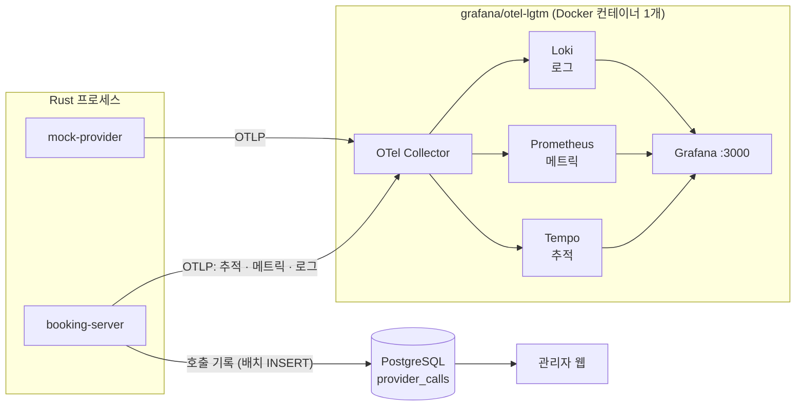

# 05. 관측과 분석

## 1. 전체 구성



- 앱은 **OpenTelemetry(OTLP)로만** 내보낸다. 받는 쪽을 Datadog이나 OpenObserve 등으로 바꿔도 코드는 그대로다 (`OTEL_EXPORTER_OTLP_ENDPOINT`만 바꾸면 됨). → [D-06](decisions.md#d-06-관측은-opentelemetryotlp-단일-경로-로컬은-grafanaotel-lgtm)
- 로컬 개발 중에는 사람이 읽기 쉬운 형식으로 콘솔에도 로그를 출력한다.

## 2. 데이터 두 갈래: 메트릭과 호출 기록

| | 메트릭 (Prometheus) | 호출 기록 (`provider_calls`) |
|---|---|---|
| 용도 | 실시간 대시보드, 알림 | 관리자 화면 분석, 예약별 추적 |
| 저장 | 집계값 (히스토그램 버킷) | 호출 1회 = 1행 |
| p95 | **근사값** (버킷 경계로 보간) | **정확한 값** (`percentile_cont`) |
| 조건 | 라벨(업체 · 작업 · 결과)로만 | SQL로 무엇이든 (예약별, 시도 번호별, 특정 시간대) |
| 비용 | 아주 적음 | 행 수만큼 저장 공간 |

두 p95를 나란히 비교하면 히스토그램 버킷 설계가 p95 정확도에 얼마나 영향을 주는지 직접 확인할 수 있다.

## 3. 추적 (Traces)

span 구조:
```
POST /v1/bookings                                  [http server]
└─ booking.accept  booking_id=…
   └─ db: INSERT bookings / jobs

(jobs.trace_context로 연결 — span link)

job.submit_booking  job_id=… booking_id=…          [새 trace, 위 trace를 link로 가리킴]
└─ provider.call  provider=alpha operation=create_booking
   ├─ provider.attempt  attempt=1 outcome=timeout
   │  └─ HTTP POST /alpha/v1/reservations           [http client, traceparent 전파]
   │     └─ (mock-provider) POST /alpha/v1/reservations
   └─ provider.attempt  attempt=2 outcome=success
      └─ HTTP POST …
```

- **HTTP 전파**: 업체 호출에 W3C `traceparent` 헤더를 붙인다. mock-provider도 계측되어 있으므로 업체 내부 지연까지 한 trace에서 보인다.
- **작업 큐 전파**: 작업은 몇 분 뒤에 실행될 수도 있으므로 같은 trace에 이어 붙이지 않고 **span link**로 연결한다 (OpenTelemetry가 비동기 메시징에 권장하는 방식).
- 모든 span에 `booking_id`를 속성으로 넣어서 예약 ID로 검색할 수 있게 한다.
- 관리자 웹 예약 상세에서 `trace_id`를 누르면 Grafana(Tempo) 화면으로 이동한다.

## 4. 메트릭 목록

이름은 OpenTelemetry 표기(점으로 구분)다. Prometheus에서는 `_`로 바뀌고 단위 접미사가 붙는다.

| 이름 | 종류 | 라벨 | 설명 |
|---|---|---|---|
| `http.server.request.duration` | histogram (s) | route, method, status | 우리 API 응답 시간 |
| `provider.call.duration` | histogram (s) | provider, operation, outcome | 업체 호출 1회(시도) 시간 |
| `provider.call.retries` | counter | provider, operation | 호출 내 재시도 횟수 |
| `provider.rate_limit.remaining` | gauge | provider | 업체가 알려 준 남은 호출 수 |
| `provider.throttled` | counter | provider, source=`local`\|`remote` | 우리 limiter 대기 초과 / 업체 429 · 503 |
| `provider.paused` | gauge (0/1) | provider | Retry-After로 쉬는 중 |
| `provider.circuit.state` | gauge (0=closed, 1=half_open, 2=open) | provider | |
| `provider.bulkhead.in_flight` | gauge | provider | 동시에 실행 중인 호출 수 |
| `booking.transitions` | counter | provider, from, to | 상태 전이 |
| `booking.time_to_final` | histogram (s) | provider, final_status | 접수부터 종료 상태까지 걸린 시간 |
| `jobs.ready` | gauge | kind | 실행 대기 작업 수 |
| `jobs.dead` | gauge | kind | dead 작업 수 |
| `jobs.lag` | histogram (s) | kind | `run_at`부터 실제 시작까지의 지연 |
| `provider_calls.recorder.dropped` | counter | | 호출 기록 버퍼가 가득 차서 버린 건수 |

히스토그램 버킷(초): `0.005, 0.01, 0.025, 0.05, 0.1, 0.25, 0.5, 1, 2.5, 5, 10`. OpenTelemetry 기본 버킷은 밀리초 기준이라 초 단위와 맞지 않으므로 반드시 직접 지정한다.

**라벨 원칙**: `booking_id`처럼 값이 끝없이 늘어나는 것은 라벨로 쓰지 않는다 (메트릭 저장소가 폭발한다). 그런 값은 추적 속성이나 로그에 넣는다.

## 5. 로그

- `tracing`의 구조화 필드를 쓴다: `info!(booking_id = %id, from = ?old, to = ?new, "booking transitioned")`
- 모든 로그 줄에 `trace_id`와 `span_id`가 자동으로 붙는다. Grafana에서 로그와 추적을 오갈 수 있다.
- 개인정보(고객 이름 · 전화번호)는 로그에 남기지 않는다. `Customer` 타입의 `Debug` 구현에서 값을 가린다.

## 6. 호출 기록기 (Call Recorder)

DB 쓰기 때문에 업체 호출 경로가 느려지면 안 된다.

```
provider.attempt 완료 ──try_send──▶ [mpsc 채널, 용량 10,000] ──▶ 기록 태스크
                                                              (1초마다 또는 500건마다 배치 INSERT)
채널이 가득 차면: 기다리지 않고 버리고 dropped 카운터를 올린다
```
"관측 때문에 서비스가 느려지면 안 된다"는 원칙을 따른다. Rust의 채널과 배압(backpressure)을 연습하기에도 좋다.

## 7. 분석 쿼리 (관리자 통계 API의 기반)

구간별 p50/p95/p99와 결과 분포:
```sql
SELECT
  date_bin(interval '5 minutes', started_at, timestamptz '2000-01-01') AS bucket,
  count(*)                                                    AS calls,
  count(*) FILTER (WHERE outcome = 'success')                 AS success,
  count(*) FILTER (WHERE outcome = 'rate_limited')            AS rate_limited,
  count(*) FILTER (WHERE attempt > 1)                         AS retries,
  percentile_cont(0.50) WITHIN GROUP (ORDER BY duration_ms)
      FILTER (WHERE outcome NOT IN ('circuit_open', 'throttled')) AS p50,
  percentile_cont(0.95) WITHIN GROUP (ORDER BY duration_ms)
      FILTER (WHERE outcome NOT IN ('circuit_open', 'throttled')) AS p95,
  percentile_cont(0.99) WITHIN GROUP (ORDER BY duration_ms)
      FILTER (WHERE outcome NOT IN ('circuit_open', 'throttled')) AS p99,
  min(rate_limit_remaining)                                   AS min_remaining
FROM provider_calls
WHERE provider_id = $1 AND started_at >= $2 AND started_at < $3
GROUP BY bucket
ORDER BY bucket;
```
`circuit_open`과 `throttled`는 실제로 호출하지 않아 0ms에 가까우므로 지연 통계에서 뺀다. 넣으면 p95가 실제보다 좋아 보인다.

## 8. 대시보드와 알림

`observability/grafana/`에 대시보드 JSON을 코드로 관리하고, 컨테이너가 시작될 때 자동으로 등록(provisioning)한다.

| 대시보드 | 패널 |
|---|---|
| Provider Overview | 업체별 초당 호출 수, 성공률, p50/p95/p99, 결과별 비율, 429 · 503, 서킷 상태 타임라인, rate limit 여유 |
| Booking Pipeline | 상태 전이 흐름, 접수 → 확정 시간 p95, 대기 · dead 작업 수, 작업 지연 |
| Service | API 요청 수 · 에러율 · 지연, tokio 런타임 지표 |

### SLO (우리가 책임지는 목표)
| SLO | 목표 |
|---|---|
| 예약 처리 완결률: 기한 안에 `confirmed` 또는 `rejected`에 도달한 비율 | 99% 이상 (28일) |
| 접수 → 확정 시간 p95 (업체 정상 시) | 5초 미만 |
| 예약 API 가용성 (5xx가 아닌 응답의 비율) | 99.9% 이상 |

업체 자체의 성공률과 지연은 우리가 통제할 수 없으므로 SLO가 아니라 **관찰 지표**로 둔다.

### 알림 규칙
| 조건 | 심각도 |
|---|---|
| 서킷이 5분 넘게 Open | 경고 |
| dead 작업이 1건 이상 | 경고 |
| `unknown` 상태가 10분 넘게 유지 | 경고 |
| 대사에서 이중 예약 의심 발견 | 긴급 |
| 업체 호출 중 rate_limited 비율 5% 초과 (10분) | 경고 |
| 작업 지연 p95가 30초 초과 | 경고 |
| `provider_calls.recorder.dropped` 증가 | 정보 |

## 9. Rust 전용 진단 도구

| 도구 | 용도 | 사용 시점 |
|---|---|---|
| **tokio-console** | 비동기 태스크별 실행 · 대기 시간, 오래 막힌 태스크를 실시간으로 확인 | 개발 중 "왜 멈췄지?"를 진단할 때. `tokio_unstable` 설정이 필요하므로 개발 빌드에서만 켠다 |
| pprof-rs / cargo-flamegraph | CPU 프로파일, flame graph | 부하 테스트 중 병목을 찾을 때 |
